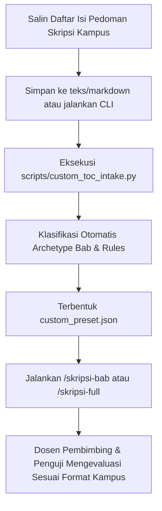

# Panduan Pemetaan Sistematika Skripsi Kustom (Custom TOC Mapper)

## 1. Latar Belakang & Filosofi Desain

Setiap perguruan tinggi di Indonesia memiliki pedoman penulisan skripsi (*gaya selingkung*) yang memiliki kekhasan masing-masing:
- **Rumpun Sosial, Humaniora & Pendidikan**: Lazimnya menggunakan sistematika klasik 5 bab (Bab I Pendahuluan, Bab II Kajian Pustaka, Bab III Metodologi, Bab IV Hasil & Pembahasan, Bab V Penutup).
- **Rumpun Informatika & Rekayasa Perangkat Lunak (IT/SE)**: Umumnya membagi bab metodologi dan hasil menjadi Bab 3 (Analisis & Desain Sistem) dan Bab 4 (Implementasi & Pengujian Sistem).
- **Rumpun Ilmu Hukum (Fakultas Hukum)**: Menggunakan Bab II Tinjauan Pustaka, Bab III Metode Penelitian Hukum (Normatif/Empiris), dan Bab IV Hasil Penelitian dan Pembahasan Isu Hukum.
- **Rumpun Kependidikan (FKIP R&D)**: Menggunakan Bab III Model Pengembangan (ADDIE, 4D, Borg & Gall), dan Bab IV Hasil Pengembangan dan Validasi Ahli.
- **Sistematika Non-Standar**: Beberapa kampus membagi bab menjadi 6 bab atau menggunakan penomoran subbab khusus (huruf A, B, C atau 1.1, 1.2).

`nyekripsi` menyediakan **Custom TOC Intake Engine** (`scripts/custom_toc_intake.py`) untuk menjembatani naskah pedoman skripsi kampus mana pun dengan mesin orkestrasi `nyekripsi`. Prinsip utamanya adalah:

> **Adaptasi Format Fleksibel 100%, Preservasi Rigor Ilmiah 100%**  
> Struktur bab dan subbab menyesuaikan pedoman kampus Anda secara presisi, namun kaidah mutu akademik (rumusan dialektis `terdapat...`, kajian teori 3 level, matriks 13 kolom, anti-phantom citation, dan EYD V) tetap ditegakkan tanpa kompromi.

---

## 2. Alur Penggunaan (Workflow)



---

## 3. Format Masukan yang Didukung

Mesin intake mendukung 4 format masukan berbeda:

### Format A: Teks Mentah dari Salinan PDF (Plain Text)
Anda dapat menyalin langsung teks daftar isi dari buku pedoman skripsi fakultas (termasuk nomor halaman dan titik-titik daftar isi):

```text
BAB I: PENDAHULUAN ......... 1
1.1 Latar Belakang Masalah ......... 1
1.2 Rumusan Masalah ......... 5
1.3 Tujuan Penelitian ......... 6
1.4 Batasan Masalah ......... 7
1.5 Manfaat Penelitian ......... 8

BAB II: LANDASAN TEORI ......... 9
2.1 Tinjauan Pustaka Terdahulu ......... 9
2.2 Teori Konseptual ......... 15
2.3 Kerangka Pemikiran ......... 22

BAB III: METODE PENELITIAN ......... 25
3.1 Desain Penelitian ......... 25
3.2 Populasi dan Sampel ......... 27
3.3 Teknik Pengumpulan Data ......... 30
3.4 Teknik Analisis Data ......... 33

BAB IV: HASIL DAN PEMBAHASAN ......... 37
4.1 Gambaran Umum Objek Penelitian ......... 37
4.2 Hasil Analisis Data ......... 42
4.3 Pembahasan Temuan ......... 55

BAB V: SIMPULAN DAN SARAN ......... 63
5.1 Simpulan ......... 63
5.2 Saran ......... 65
```

### Format B: Markdown Outline
```markdown
# Pedoman Skripsi Fasilkom
## BAB I PENDAHULUAN
- 1.1 Latar Belakang
- 1.2 Rumusan Masalah
- 1.3 Tujuan Penelitian
- 1.4 Ruang Lingkup

## BAB II TINJAUAN PUSTAKA
- 2.1 Penelitian Terkait
- 2.2 Landasan Teori
- 2.3 Kerangka Konseptual

## BAB III ANALISIS DAN PERANCANGAN SISTEM
- 3.1 Metodologi Pengembangan (Scrum)
- 3.2 Analisis Kebutuhan Fungsional & Non-Fungsional
- 3.3 Perancangan Arsitektur Perangkat Lunak
- 3.4 Perancangan Basis Data dan Antarmuka

## BAB IV IMPLEMENTASI DAN PENGUJIAN
- 4.1 Lingkungan Implementasi
- 4.2 Implementasi Modul Utama
- 4.3 Pengujian Black-Box
- 4.4 Pengujian Usability (SUS)

## BAB V PENUTUP
- 5.1 Kesimpulan
- 5.2 Saran Pengembangan
```

### Format C: File JSON Konfigurasi (`faculty-preset-v1.json`)
Konfigurasi terstruktur yang langsung mendefinisikan aturan dan batasan bab.

### Format D: File YAML Outline
File YAML terstruktur dengan blok `chapters:`, `title:`, dan `required_sections:`.

---

## 4. Panduan Pemetaan Archetype Semantik & Template

Mesin intake secara cerdas memetakan setiap bab ke dalam **Canonical Archetype** yang mengaktifkan template dan rubrik pembimbingan yang relevan:

| Canonical Archetype | Kata Kunci Pengenal | Template Rujukan Utama | Aturan Mutu yang Melekat Otomatis |
|---|---|---|---|
| `introduction` | Pendahuluan, Latar Belakang, Rumusan Masalah, Tujuan | `academic-paper/templates/skripsi_bab1_template.md` | - Latar belakang memuat dialektika `terdapat...`<br>- Minimal 3 Research Questions (RQs)<br>- Pemisahan Objek Material & Objek Formal |
| `literature_review` | Kajian Pustaka, Tinjauan Pustaka, Landasan Teori, Kerangka Berpikir | `academic-paper/templates/skripsi_bab2_template.md` | - Matriks Penelitian Terdahulu 13 Kolom (min. 10 studi)<br>- Hierarki Teori 3 Level (Grand, Middle, Applied)<br>- Diagram Kerangka Berpikir Mermaid |
| `system_design` | Analisis dan Perancangan, Perancangan Sistem, Desain Arsitektur | `academic-paper/templates/skripsi_bab3_it_se_template.md` | - Diagram UML Mermaid (Use Case, Activity, Sequence, Class)<br>- Spesifikasi FR dan NFR terukur |
| `methodology` | Metode Penelitian, Metodologi, Desain Penelitian, Bahan Hukum | `academic-paper/templates/skripsi_bab3_template.md` | - Uji instrumen (validitas Pearson, Cronbach's Alpha $> 0.70$)<br>- Protokol sampling atau triangulasi sumber/waktu |
| `implementation_testing`| Implementasi dan Pengujian, Evaluasi Sistem, Hasil Pengujian | `academic-paper/templates/skripsi_bab4_it_se_template.md` | - Minimal 10 skenario pengujian Black-Box<br>- Evaluasi kepuasan pengguna System Usability Scale (SUS) $> 68$ |
| `results_discussion` | Hasil dan Pembahasan, Hasil Penelitian, Analisis Data | `academic-paper/templates/skripsi_bab4_template.md` | - Pembahasan 3 Arah (triangulasi temuan empiris vs teori vs matriks studi terdahulu) |
| `conclusion` | Penutup, Kesimpulan, Simpulan dan Saran | `academic-paper/templates/skripsi_bab5_template.md` | - Formulasi *Natijah* epistemik answering 3 RQs secara langsung tanpa spekulasi |
| `custom_specialized` | Bab spesifik bidang (misal: Studi Kasus Lapangan Mandiri) | Konfigurasi fleksibel | - Standar sitasi APA 7 / IEEE, 80% jurnal mutakhir, EYD V |

---

## 5. Cara Menjalankan CLI Intake

Eksekusi skrip intake dari direktori root:

```bash
# Contoh 1: Konversi file teks outline menjadi custom_preset.json
python3 scripts/custom_toc_intake.py \
  --input pedoman_skripsi_ui.txt \
  --output custom_preset.json \
  --preset-name "Pedoman Skripsi Fasilkom UI" \
  --campus-name "Universitas Indonesia" \
  --faculty-name "Fakultas Ilmu Komputer" \
  --citation-style IEEE

# Contoh 2: Masukan langsung teks outline via terminal
python3 scripts/custom_toc_intake.py \
  --text "BAB I PENDAHULUAN\n1.1 Latar Belakang\n1.2 Rumusan Masalah\nBAB II LANDASAN TEORI\n..." \
  --output my_custom_toc.json

# Contoh 3: Validasi apakah file JSON memenuhi skema preset
python3 scripts/custom_toc_intake.py \
  --input custom_preset.json \
  --validate
```

---

## 6. Integrasi dengan Perintah Slash (`/skripsi-*`)

Setelah file `custom_preset.json` terbuat, Anda dapat langsung menggunakannya pada perintah skripsi:

### Menulis Bab Tertentu Sesuai Outline Kampus:
```text
/skripsi-bab --bab 3 --fakultas custom --toc custom_preset.json
```
Pada pemanggilan ini:
1. `academic-paper` membaca `custom_preset.json`.
2. Bab 3 akan otomatis dideteksi apakah bertipe `methodology` atau `system_design`.
3. Seluruh subbab yang diwajibkan oleh kampus Anda akan dihasilkan secara lengkap.
4. `pembimbing_agent` akan memeriksa draf terhadap daftar subbab yang dideklarasikan.

### Menulis Draf Proposal Sesuai Pedoman:
```text
/skripsi-proposal --fakultas custom --toc custom_preset.json --judul "Rancang Bangun Sistem Informasi Logistik Menggunakan Arsitektur Microservices"
```

### Eksekusi Simulasi Sidang Berbasis Struktur Kustom:
```text
/skripsi-defense --draft draf_skripsi_lengkap.md --fakultas custom
```
Majelis Dewan Penguji (`penguji_agent`) akan mengevaluasi naskah dengan memastikan seluruh subbab pedoman kampus Anda telah terisi secara komprehensif.

---

## 7. Exemplar Kasus Nyata Kampus Indonesia

### Exemplar 1: Rumpun Informatika & SE (Universitas Indonesia / ITB)
- **Karakteristik**: Menggunakan gaya sitasi IEEE (`[1]`, `[2]`), Bab 3 berfokus pada analisis kebutuhan dan pemodelan diagram UML, Bab 4 berfokus pada implementasi kode dan uji Black-Box / SUS.
- **Hasil Klasifikasi Intake**:
  - Bab 1: `introduction` (Rules: `terdapat`, 3 RQs)
  - Bab 2: `literature_review` (Rules: 10 jurnal, matriks 13 kolom, diagram Mermaid)
  - Bab 3: `system_design` (Rules: diagram use case, activity, sequence, class Mermaid)
  - Bab 4: `implementation_testing` (Rules: tabel pengujian blackbox, evaluasi SUS)
  - Bab 5: `conclusion` (Rules: kesimpulan ketercapaian fungsionalitas)

### Exemplar 2: Rumpun Ilmu Hukum (Universitas Gadjah Mada / UNPAD)
- **Karakteristik**: Penelitian Hukum Normatif menggunakan pendekatan perundang-undangan (*statute approach*) dan pendekatan konseptual (*conceptual approach*). Bab III berjudul *Metode Penelitian Hukum*, Bab IV berjudul *Hasil Penelitian dan Pembahasan Isu Hukum*.
- **Hasil Klasifikasi Intake**:
  - Bab I: `introduction`
  - Bab II: `literature_review` (Tinjauan Pustaka Konseptual)
  - Bab III: `methodology` (Bahan hukum primer, sekunder, tersier; teknik penelusuran bahan hukum)
  - Bab IV: `results_discussion` (Analisis isu hukum 1 dan isu hukum 2)
  - Bab V: `conclusion` (Simpulan preskriptif hukum)

### Exemplar 3: Rumpun Kependidikan / FKIP (Universitas Pendidikan Indonesia / UNY)
- **Karakteristik**: Penelitian dan Pengembangan (*Research and Development* / R&D) menggunakan model ADDIE atau 4D. Bab III memuat tahapan pengembangan, Bab IV memuat hasil validasi instrumen/materi oleh ahli (*expert appraisal*) dan uji coba pengguna.
- **Hasil Klasifikasi Intake**:
  - Bab I: `introduction`
  - Bab II: `literature_review` (Kajian Teori Belajar & Pengembangan Media)
  - Bab III: `methodology` (Model Pengembangan ADDIE: Analysis, Design, Development, Implementation, Evaluation)
  - Bab IV: `results_discussion` (Hasil validasi ahli materi, media, dan uji coba lapangan terbatas)
  - Bab V: `conclusion` (Simpulan kelayakan produk dan saran pemanfaatan)

---

## 8. Kesimpulan

Dengan arsitektur **Custom TOC Mapper**, `nyekripsi` menjadi instrumen penulisan tugas akhir paling adaptif di Indonesia. Anda tidak perlu memaksakan template generik asing; cukup berikan daftar isi pedoman skripsi kampus Anda, dan seluruh agen, linter, dan template akan menyelaraskan diri secara otomatis.
