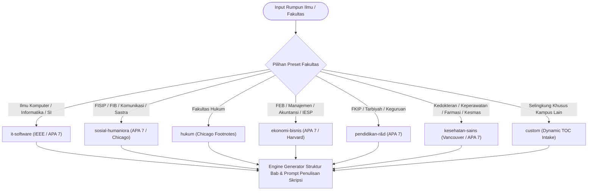

# Pedoman Sistem Preset Fleksibilitas Fakultas Universal (Skripsi S1 Indonesia)

**Status:** Normatif / Standar Sistem `nyekripsi`  
**Sasaran Pengguna:** Mahasiswa Seluruh Rumpun Ilmu, Dosen Pembimbing, Dosen Penguji, dan Tim Audit Mutu Skripsi  
**Rujukan Regulasi & Standar:** Permendikbudristek No. 53 Tahun 2023 (Penjaminan Mutu Pendidikan Tinggi), Standar Nasional Pendidikan Tinggi (SN-Dikti), Pedoman Penulisan Skripsi Universitas-Universitas Terkemuka di Indonesia (UI, UGM, ITB, Unpad, Undip, Unair, UPI).

---

## 1. Arsitektur Preset Fleksibilitas Fakultas Universal

Keragaman tradisi keilmuan dan pedoman penulisan karya ilmiah (*selingkung kampus*) antar-fakultas di Indonesia menuntut fleksibilitas arsitektural. `nyekripsi` menyediakan **7 Universal Faculty Presets** yang dirancang untuk mengonfigurasi judul bab, struktur sub-bab, gaya sitasi, instrumen analitis, dan rubrik evaluasi secara otomatis.



---

## 2. Spesifikasi Rinci 7 Preset Fakultas Universal

---

### 2.1 Preset 1: `it-software`
- **Rumpun Ilmu:** Ilmu Komputer, Teknik Informatika, Sistem Informasi, Rekayasa Perangkat Lunak, Teknologi Informasi.
- **Standar Sitasi:** **IEEE Numeric** (`[1]`, `[2]`) atau **APA 7th Edition**.
- **Karakteristik Kunci:** Bab III dialihkan secara khusus menjadi *Analisis dan Desain Sistem*, sedangkan Bab IV difokuskan pada *Implementasi dan Pengujian Sistem*.
- **Struktur Bab & Sub-Bab:**
  * **Bab I: Pendahuluan**
    - 1.1 Latar Belakang Masalah (Urgensi digitalisasi, identifikasi *gap* operasional sistem)
    - 1.2 Rumusan Masalah (Pernyataan permasalahan arsitektur sistem)
    - 1.3 Batasan Masalah (Ruang lingkup modul, teknologi, dan platform sasaran)
    - 1.4 Tujuan Penelitian (Tujuan rekayasa artefak perangkat lunak)
    - 1.5 Manfaat Penelitian (Manfaat teknis, akademis, dan manajerial)
  * **Bab II: Kajian Pustaka & Kerangka Berpikir**
    - 2.1 Penelitian Terdahulu (Matriks komparasi 13 kolom algoritma/sistem sejenis)
    - 2.2 Landasan Teori (SWEBOK, prinsip arsitektur, algoritma spesifik)
    - 2.3 Kerangka Berpikir (Diagram alur perancangan solusi teknis)
  * **Bab III: Analisis dan Desain Sistem**
    - 3.1 Metodologi Pengembangan Sistem (Agile/Scrum, Waterfall, Prototyping, R&D)
    - 3.2 Analisis Kebutuhan Sistem (Kebutuhan Fungsional FR & Non-Fungsional NFR FURPS+)
    - 3.3 Pemodelan Arsitektur Sistem & Diagram UML (Mermaid Flowchart, Sequence, Class Diagram)
    - 3.4 Perancangan Basis Data (Entity Relationship Diagram - ERD) & Antarmuka UI/UX
    - 3.5 Rencana Pengujian Sistem (Rancangan pengujian Black Box, SUS, UAT, Stress Test)
  * **Bab IV: Implementasi dan Pengujian Sistem**
    - 4.1 Lingkungan Implementasi (Spesifikasi perangkat keras, sistem operasi, pustaka perangkat lunak)
    - 4.2 Implementasi Antarmuka & Modul Kode Sumber Utama
    - 4.3 Pengujian Kotak Hitam (*Black-Box Testing* - Partisi Ekivalensi & BVA)
    - 4.4 Pengujian Kebergunaan Sistem (*System Usability Scale* - SUS)
    - 4.5 Pengujian Keberterimaan Pengguna (*User Acceptance Testing* - UAT)
    - 4.6 Pengujian Kinerja Beban (*Stress & Performance Benchmarking*)
  * **Bab V: Penutup**
    - 5.1 Kesimpulan (Keberhasilan pencapaian spesifikasi fungsional dan skor kualitas sistem)
    - 5.2 Saran (Pengembangan fitur masa depan, optimasi skalabilitas)

---

### 2.2 Preset 2: `sosial-humaniora`
- **Rumpun Ilmu:** FISIP (Ilmu Komunikasi, Hubungan Internasional, Sosiologi, Ilmu Politik, Administrasi Publik), FIB / Humaniora (Sastra, Bahasa, Kajian Budaya, Sejarah, Antropologi).
- **Standar Sitasi:** **APA 7th Edition** atau **Chicago Manual of Style (Author-Date / Notes-Bib)**.
- **Karakteristik Kunci:** Mempertahankan struktur klasik Bab I s.d. Bab V dengan kedalaman dialektika teoretis dan penyingkapan makna laten.
- **Struktur Bab & Sub-Bab:**
  * **Bab I: Pendahuluan**
    - 1.1 Latar Belakang Masalah (Dilema fenomena sosial kontemporer, perdebatan wacana)
    - 1.2 Identifikasi & Rumusan Masalah (Pernyataan "terdapat...", 3 pertanyaan penelitian dari umum ke khusus)
    - 1.3 Tujuan Penelitian
    - 1.4 Manfaat Penelitian (Manfaat teoretis keilmuan dan praktis 3 sasaran)
  * **Bab II: Kajian Pustaka & Kerangka Teori**
    - 2.1 Penelitian Terdahulu (Matriks komparasi 13 kolom riset terdahulu)
    - 2.2 Landasan Teori Tiga Level (Grand Theory, Middle-Range Theory, Applied Theory)
    - 2.3 Kerangka Konseptual / Berpikir (Diagram alur logis hulu ke hilir)
  * **Bab III: Metode Penelitian**
    - 3.1 Pendekatan & Jenis Penelitian (Kualitatif Studi Kasus / Fenomenologi / Etnografi / Kuantitatif Survei)
    - 3.2 Objek Material dan Objek Formal Penelitian
    - 3.3 Lokus Penelitian & Korpus Data / Informan Purposif
    - 3.4 Teknik Pengumpulan Data (Wawancara mendalam, observasi partisipatif, dokumen, FGD)
    - 3.5 Keabsahan Data (Kredibilitas, Transferabilitas, Dependabilitas, Konfirmabilitas, Triangulasi 4 jenis)
    - 3.6 Prosedur Analisis Data Tiga Tahap (Inventarisasi -> Klasifikasi -> Penafsiran dengan Pisau Analisis)
  * **Bab IV: Hasil Penelitian dan Pembahasan Dialektis**
    - 4.1 Gambaran Umum Lokus dan Profil Subjek Penelitian
    - 4.2 Hasil Penelitian (Temuan empiris terstruktur per pertanyaan penelitian)
    - 4.3 Pembahasan Dialektis (Membedah data dengan pisau analisis, konfirmasi/perluasan/bantahan terhadap teori rujukan)
  * **Bab V: Kesimpulan dan Rekomendasi**
    - 5.1 Kesimpulan (Natijah sarat nilai pengetahuan)
    - 5.2 Keterbatasan Penelitian
    - 5.3 Rekomendasi (Rekomendasi teoretis dan rekomendasi praktis kebijakan)

---

### 2.3 Preset 3: `hukum`
- **Rumpun Ilmu:** Ilmu Hukum (Hukum Pidana, Hukum Perdata, Hukum Tata Negara, Hukum Administrasi Negara, Hukum Bisnis, Hukum Internasional).
- **Standar Sitasi:** **Chicago Manual of Style (Full Notes / Footnotes)** atau **Turabian Style**.
- **Karakteristik Kunci:** Klasifikasi hierarki Bahan Hukum (Primer, Sekunder, Tersier) dan penggunaan pendekatan khas ilmu hukum (*statute, case, conceptual approaches*).
- **Struktur Bab & Sub-Bab:**
  * **Bab I: Pendahuluan**
    - 1.1 Latar Belakang Masalah (Kesenjangan *das Sollen* norma hukum ideal vs *das Sein* realitas penerapan)
    - 1.2 Identifikasi & Rumusan Masalah Hukum (*Legal Issues* - pertentangan norma/kekosongan hukum/kaburnya norma)
    - 1.3 Tujuan Penelitian Hukum
    - 1.4 Manfaat Penelitian (Pengembangan doktrin hukum dan pembaharuan regulasi praktis)
    - 1.5 Kerangka Konseptual & Definisi Operasional Istilah Yuridis
  * **Bab II: Tinjauan Pustaka / Landasan Teoretis Hukum**
    - 2.1 Landasan Teori Hukum (Teori Hukum Murni Hans Kelsen, Teori Positivisme H.L.A. Hart, Teori Keadilan John Rawls, Teori Utilitarianisme Bentham, Teori Asas-Asas Hukum)
    - 2.2 Tinjauan Umum Lembaga / Objek Hukum yang Diteliti
    - 2.3 Kerangka Alur Pemikiran Yuridis
  * **Bab III: Metode Penelitian Hukum**
    - 3.1 Jenis Penelitian Hukum:
      * **Penelitian Hukum Normatif (Doktrinal):** Meneliti norma tertulis dan putusan pengadilan.
      * **Penelitian Hukum Empiris (Yuridis-Sosiologis):** Meneliti efektivitas hukum dalam perilaku masyarakat nyata.
    - 3.2 Pendekatan Penelitian Hukum:
      * *Statute Approach* (Pendekatan Perundang-Undangan)
      * *Case Approach* (Pendekatan Kasus / Analisis *Ratio Decidendi*)
      * *Conceptual Approach* (Pendekatan Konseptual / Doktrin Para Sarjana)
      * *Historical Approach* (Pendekatan Historis)
      * *Comparative Approach* (Pendekatan Perbandingan Hukum)
    - 3.3 Sumber dan Bahan Hukum:
      * **Bahan Hukum Primer:** UUD 1945, Undang-Undang, Peraturan Pemerintah, Putusan Pengadilan berkekuatan hukum tetap (MK / MA), Perjanjian Internasional.
      * **Bahan Hukum Sekunder:** Rancangan Undang-Undang (RUU), risalah sidang DPR, buku teks hukum otoritatif, jurnal ilmiah hukum, pendapat hukum para ahli (*doktrin*).
      * **Bahan Hukum Tersier:** Kamus Besar Bahasa Indonesia (KBBI), Black's Law Dictionary, ensiklopedia hukum.
    - 3.4 Teknik Pengumpulan & Pengolahan Bahan Hukum (Studi kepustakaan, kategorisasi norma, penelusuran asas preferensi hukum: *Lex Superior derogat legi inferiori*, *Lex Specialis derogat legi generali*, *Lex Posterior derogat legi priori*)
    - 3.5 Metode Analisis Bahan Hukum (Interpretasi gramatikal, sistematis, historis, teleologis / sosiologis)
  * **Bab IV: Hasil Penelitian dan Analisis Hukum**
    - 4.1 Analisis Pertentangan / Kekosongan Norma dalam Regulasi Terkait
    - 4.2 Analisis Ratio Decidendi Putusan Pengadilan atau Pertanggungjawaban Hukum
    - 4.3 Rekonstruksi Hukum dan Harmonisasi Norma
  * **Bab V: Penutup**
    - 5.1 Kesimpulan (Jawaban doktrinal atas rumusan masalah hukum)
    - 5.2 Saran (Rekomendasi *legislative reform* bagi pembentuk UU / pemangku kebijakan peradilan)

---

### 2.4 Preset 4: `ekonomi-bisnis`
- **Rumpun Ilmu:** Manajemen Keuangan, Manajemen Pemasaran, Manajemen SDM, Akuntansi Keuangan, Akuntansi Manajemen, Ilmu Ekonomi / Studi Pembangunan.
- **Standar Sitasi:** **APA 7th Edition** atau **Harvard Style**.
- **Karakteristik Kunci:** Dominasi model ekonometrika, analisis regresi data panel, analisis rasio keuangan, atau pemodelan persamaan struktural (SEM-PLS / AMOS).
- **Struktur Bab & Sub-Bab:**
  * **Bab I: Pendahuluan**
    - 1.1 Latar Belakang Masalah (Dinamika makroekonomi, fenomena pasar modal/kinerja keuangan emiten)
    - 1.2 Rumusan Masalah (Pernyataan masalah kausalitas ekonomi)
    - 1.3 Tujuan Penelitian
    - 1.4 Manfaat Penelitian (Manfaat akademis, implikasi manajerial bagi direksi/investor)
  * **Bab II: Kajian Pustaka, Kerangka Pemikiran, dan Hipotesis**
    - 2.1 Kajian Penelitian Terdahulu (Matriks komparasi 13 kolom riset empiris terdahulu)
    - 2.2 Landasan Teori Tiga Level (Grand: *Agency Theory* / *Signaling Theory*; Middle: *Pecking Order Theory* / *Trade-off Theory*; Applied: Rasio Profitabilitas ROA/ROE, Leverage DER, Likuiditas CR)
    - 2.3 Kerangka Pemikiran (Model struktural hubungan kausal antar-variabel)
    - 2.4 Pengembangan Hipotesis ($H_1, H_2, H_3$ berdasarkan sintesis logika teoretis dan bukti empiris)
  * **Bab III: Metode Penelitian**
    - 3.1 Desain Penelitian (Kuantitatif asosiatif kausal)
    - 3.2 Objek Penelitian, Populasi, dan Penentuan Sampel (*Purposive Sampling* di Bursa Efek Indonesia / IDX)
    - 3.3 Operasionalisasi Variabel (Variabel independen, dependen, moderasi/mediasi, variabel kontrol)
    - 3.4 Metode Pengumpulan Data (Data sekunder laporan keuangan tahunan / *annual reports*)
    - 3.5 Metode Analisis Data:
      * **Regresi Data Panel:** *Common Effect Model* (CEM), *Fixed Effect Model* (FEM), *Random Effect Model* (REM)
      * **Uji Pemilihan Model Panel:** *Chow Test* (CEM vs FEM), *Hausman Test* (FEM vs REM), *Lagrange Multiplier LM Test* (CEM vs REM)
      * **Uji Asumsi Klasik:** Normalitas residual, multikolinearitas (VIF), heteroskedastisitas (Glejser/Park), autokorelasi (Durbin-Watson / Breusch-Godfrey)
      * **Analisis SEM-PLS:** *Measurement Model / Outer Model* (Validitas konvergen, validitas diskriminan Fornell-Larcker / HTMT, reliabilitas komposit), *Structural Model / Inner Model* ($R^2$, $f^2$, $Q^2$, path coefficients)
  * **Bab IV: Hasil Penelitian dan Pembahasan**
    - 4.1 Statistik Deskriptif Variabel Penelitian
    - 4.2 Hasil Estimasi Model Regresi Data Panel & Uji Pemilihan Model
    - 4.3 Hasil Pengujian Asumsi Klasik
    - 4.4 Hasil Uji Hipotesis (Uji t parsial, Uji F simultan, Koefisien Determinasi $R^2$)
    - 4.5 Pembahasan Manajerial & Dialektika Teoretis
  * **Bab V: Kesimpulan dan Saran**
    - 5.1 Kesimpulan (Hasil pembuktian hipotesis penelitian)
    - 5.2 Implikasi Manajerial
    - 5.3 Keterbatasan Penelitian & Saran bagi Peneliti Mendatang

---

### 2.5 Preset 5: `pendidikan-r&d`
- **Rumpun Ilmu:** FKIP, FIP, Tarbiyah, Pendidikan Bahasa, Pendidikan Matematika & Sains, Pendidikan Vokasi/Kejuruan.
- **Standar Sitasi:** **APA 7th Edition**.
- **Karakteristik Kunci:** Penelitian dan Pengembangan (*Research and Development* / R&D model ADDIE, 4D, Borg & Gall) dan Penelitian Tindakan Kelas (PTK), evaluasi kelayakan media oleh ahli, dan penghitungan efektivitas peningkatan belajar melalui formula **N-Gain Score**.
- **Struktur Bab & Sub-Bab:**
  * **Bab I: Pendahuluan**
    - 1.1 Latar Belakang Masalah (Masalah rendahnya hasil belajar/literasi, kesenjangan media pembelajaran di kelas)
    - 1.2 Identifikasi & Rumusan Masalah (Pertanyaan kebutuhan, kelayakan, kepraktisan, dan efektivitas produk)
    - 1.3 Tujuan Pengembangan / Tindakan
    - 1.4 Spesifikasi Produk yang Diharapkan
    - 1.5 Pentingnya Pengembangan & Asumsi Keterbatasan
  * **Bab II: Kajian Pustaka dan Kerangka Berpikir**
    - 2.1 Penelitian Relevan Terdahulu (Matriks 13 kolom)
    - 2.2 Landasan Teori Pembelajaran (Teori Konstruktivisme Piaget/Vygotsky, Teori Kognitivisme, Model Pembelajaran)
    - 2.3 Kerangka Berpikir Pengembangan Produk (Alur konseptual pemecahan masalah pembelajaran)
  * **Bab III: Metode Penelitian dan Pengembangan (R&D / PTK)**
    - 3.1 Model Pengembangan (Model ADDIE, Model 4D Thiagarajan, atau Model Borg & Gall) / Desain Siklus PTK
    - 3.2 Prosedur Pengembangan (Tahap Analisis, Desain, Pengembangan, Implementasi, Evaluasi)
    - 3.3 Uji Coba Produk:
      * Desain Uji Coba (Uji Satu-satu / *One-to-One*, Uji Kelompok Kecil / *Small Group*, Uji Lapangan Terbatas / *Field Trial*)
      * Subjek Uji Coba (Siswa kelas target)
    - 3.4 Instrumen Pengumpulan Data:
      * Lembar Angket Validasi Ahli Materi & Ahli Media (Skala Likert 1–5)
      * Angket Respon Guru dan Siswa (Kepraktisan)
      * Tes Hasil Belajar (*Pretest* dan *Posttest*)
    - 3.5 Teknik Analisis Data:
      * Analisis Kelayakan Produk (Persentase skor validasi ahli)
      * **Rumus Uji Efektivitas Peningkatan Belajar - Normalized Gain (N-Gain Score Hake, 1998):**
        $$g = \frac{\text{Skor Posttest} - \text{Skor Pretest}}{\text{Skor Maksimum Ideal} - \text{Skor Pretest}}$$
      * **Kriteria Efektivitas N-Gain:**
        - $g > 0,70$ $\implies$ **Efektivitas Tinggi**
        - $0,30 \le g \le 0,70$ $\implies$ **Efektivitas Sedang**
        - $g < 0,30$ $\implies$ **Efektivitas Rendah**
  * **Bab IV: Hasil Pengembangan dan Pembahasan**
    - 4.1 Deskripsi Produk Awal Prototipe
    - 4.2 Hasil Validasi Ahli Materi dan Ahli Media (Beserta Saran Revisi)
    - 4.3 Hasil Uji Kepraktisan Respon Guru dan Siswa
    - 4.4 Hasil Uji Keefektifan Pembelajaran (Komparasi Pretest-Posttest & Analisis N-Gain Score)
    - 4.5 Pembahasan Efektivitas Produk Pendidikan
  * **Bab V: Simpulan dan Saran Pemanfaatan**
    - 5.1 Simpulan (Kelayakan, kepraktisan, dan efektivitas produk)
    - 5.2 Saran Pemanfaatan & Diseminasi Produk

---

### 2.6 Preset 6: `kesehatan-sains`
- **Rumpun Ilmu:** Pendidikan Dokter, Ilmu Keperawatan, Farmasi, Kesehatan Masyarakat, Ilmu Gizi, Kebidanan.
- **Standar Sitasi:** **Vancouver Style** (sitasi numerik berurutan `(1)` atau `[1]`) atau **APA 7th Edition**.
- **Karakteristik Kunci:** Wajib memiliki persetujuan Kelaikan Etik (*Ethical Clearance*) dari Komisi Etik Penelitian Kesehatan (KEPK), metodologi epidemiologis analitik (*cross-sectional, case-control, cohort*), dan analisis risiko bivariat/multivariat (Odds Ratio / Relative Risk).
- **Struktur Bab & Sub-Bab:**
  * **Bab I: Pendahuluan**
    - 1.1 Latar Belakang Masalah (Beban penyakit global/nasional, data epidemiologis WHO/Kemenkes)
    - 1.2 Rumusan Masalah Riset Klinis / Kesehatan
    - 1.3 Tujuan Penelitian (Tujuan umum dan tujuan khusus)
    - 1.4 Manfaat Penelitian (Bagi pelayanan klinis, kesehatan masyarakat, dan kebijakan preventif)
  * **Bab II: Tinjauan Pustaka dan Kerangka Konseptual**
    - 2.1 Landasan Teori Medis / Patofisiologi Penyakit
    - 2.2 Faktor Risiko & Faktor Determinan
    - 2.3 Kerangka Konseptual Hubungan Antar-Variabel
    - 2.4 Hipotesis Penelitian Klinis
  * **Bab III: Metode Penelitian**
    - 3.1 Jenis dan Desain Penelitian (Observasional Analitik: *Cross-Sectional*, *Case-Control*, *Kohort*; atau Eksperimen: *Quasi-Experiment*, *Randomized Controlled Trial* / RCT)
    - 3.2 Waktu dan Lokasi Penelitian (Rumah Sakit / Puskesmas / Laboratorium)
    - 3.3 Populasi dan Sampel (Kriteria Inklusi & Kriteria Eksklusi, Rumus Lemeshow / Sampel Proporsi)
    - 3.4 Definisi Operasional Variabel Klinis
    - 3.5 Instrumen & Bahan Penelitian (Kuesioner tervalidasi, rekam medis, alat ukur laboratorium bersertifikasi kalibrasi)
    - 3.6 **Kelaikan Etik Penelitian (*Ethical Clearance*):**
      * Persetujuan resmi dari Komisi Etik Penelitian Kesehatan (KEPK) independen.
      * Penerapan prinsip etika medis: *Beneficence*, *Non-maleficence*, *Respect for autonomy* (Formulir Persetujuan Setelah Penjelasan / *Informed Consent*), dan *Justice*.
    - 3.7 Manajemen dan Analisis Data (Analisis Univariat distribusi frekuensi; Analisis Bivariat *Chi-Square* / *Fisher's Exact* / *T-test* / *Mann-Whitney*; Estimasi *Odds Ratio* [OR] atau *Relative Risk* [RR] dengan $95\%$ Confidence Interval; Analisis Multivariat *Regresi Logistik Biner*).
  * **Bab IV: Hasil Penelitian dan Pembahasan**
    - 4.1 Karakteristik Demografis dan Klinis Subjek Penelitian
    - 4.2 Analisis Univariat Variabel Bebas dan Terikat
    - 4.3 Analisis Bivariat (Uji Hipotesis & Nilai Risiko Klinis OR / RR)
    - 4.4 Analisis Multivariat Model Prediksi
    - 4.5 Pembahasan Klinis & Perbandingan dengan Literatur Epidemiologi Mutakhir
  * **Bab V: Kesimpulan dan Saran**
    - 5.1 Kesimpulan Klinis
    - 5.2 Saran (Rekomendasi tindakan pencegahan klinis, protokol tatalaksana pasien)

---

### 2.7 Preset 7: `custom` (Dynamic Campus Handbook Intake)
- **Rumpun Ilmu:** Fleksibel / Rumpun ilmu apa pun atau universitas dengan format selingkung khusus.
- **Standar Sitasi:** Ditetapkan secara dinamis (sesuai buku pedoman kampus).
- **Karakteristik Kunci:** Memungkinkan mahasiswa memasukkan / menempelkan (*paste*) Daftar Isi atau Pedoman Skripsi resmi universitas mereka. Engine `nyekripsi` akan secara otomatis memetakan judul bab dan sub-bab sesuai skema konfigurasi kustom.

---

## 3. Skema Formal Konfigurasi Preset & JSON/YAML Specification

Format berkas spesifikasi konfigurasi preset (`skripsi_preset.json` atau `skripsi_preset.yaml`):

```json
{
  "$schema": "https://nyekripsi.org/schemas/faculty-preset-v1.json",
  "faculty_id": "it-software",
  "preset_name": "Rekayasa Perangkat Lunak & Teknologi Informasi",
  "degree_level": "S1",
  "citation_style": "IEEE",
  "recent_reference_ratio_min": 0.80,
  "recent_year_window": 5,
  "chapters": [
    {
      "number": 1,
      "title": "BAB I: PENDAHULUAN",
      "required_sections": [
        "1.1 Latar Belakang Masalah",
        "1.2 Rumusan Masalah",
        "1.3 Batasan Masalah",
        "1.4 Tujuan Penelitian",
        "1.5 Manfaat Penelitian"
      ],
      "rules": {
        "problem_statement_starter": "terdapat",
        "min_research_questions": 3
      }
    },
    {
      "number": 2,
      "title": "BAB II: KAJIAN PUSTAKA DAN KERANGKA BERPIKIR",
      "required_sections": [
        "2.1 Penelitian Terdahulu",
        "2.2 Landasan Teori",
        "2.3 Kerangka Berpikir"
      ],
      "rules": {
        "min_prior_studies": 10,
        "required_diagrams": ["Mermaid Flowchart Kerangka Berpikir"]
      }
    },
    {
      "number": 3,
      "title": "BAB III: ANALISIS DAN PERANCANGAN SISTEM",
      "required_sections": [
        "3.1 Metodologi Rekayasa Perangkat Lunak",
        "3.2 Analisis Kebutuhan Sistem (FR & NFR)",
        "3.3 Pemodelan Arsitektur Sistem (UML)",
        "3.4 Perancangan Basis Data dan Antarmuka",
        "3.5 Perancangan Pengujian Sistem"
      ],
      "rules": {
        "required_diagrams": ["Mermaid Sequence Diagram", "Mermaid Class Diagram"]
      }
    },
    {
      "number": 4,
      "title": "BAB IV: IMPLEMENTASI DAN PENGUJIAN SISTEM",
      "required_sections": [
        "4.1 Lingkungan Implementasi",
        "4.2 Implementasi Antarmuka dan Modul Kode",
        "4.3 Pengujian Kotak Hitam (Black Box Testing)",
        "4.4 Pengujian Kebergunaan Sistem (SUS)",
        "4.5 Pengujian Keberterimaan Pengguna (UAT)"
      ],
      "rules": {
        "min_blackbox_cases": 10,
        "sus_evaluation_required": true
      }
    },
    {
      "number": 5,
      "title": "BAB V: PENUTUP",
      "required_sections": [
        "5.1 Kesimpulan",
        "5.2 Saran"
      ]
    }
  ]
}
```

---

## 4. Panduan Intake Pedoman Skripsi Kustom (*Custom Chapter Configuration Protocol*)

Bagi mahasiswa yang kampusnya memiliki format selingkung di luar preset standar, ikuti protokol intake 3 langkah berikut:

### Langkah 1: Ekstraksi Daftar Isi dari Buku Pedoman Kampus
Buka dokumen PDF Pedoman Skripsi kampus Anda, salin teks Daftar Isi (TOC) Bab I sampai Bab V.

### Langkah 2: Pemetaan ke Format Konfigurasi `custom`
Susun berkas konfigurasi `custom_toc.json` di direktori proyek Anda dengan memetakan nomor bab, judul bab resmi kampus Anda, dan sub-bab yang diwajibkan:
```json
{
  "faculty_id": "custom",
  "preset_name": "Pedoman Skripsi Universitas X - Jurusan Y",
  "citation_style": "APA7",
  "chapters": [
    {
      "number": 1,
      "title": "BAB I PENDAHULUAN",
      "required_sections": ["1.1 Latar Belakang", "1.2 Fokus Penelitian", "1.3 Rumusan Masalah", "1.4 Tujuan", "1.5 Signifikansi Penelitian"]
    },
    {
      "number": 2,
      "title": "BAB II KAJIAN TEORI DAN HIPOTESIS",
      "required_sections": ["2.1 Deskripsi Teori", "2.2 Penelitian Terdahulu yang Relevan", "2.3 Kerangka Konseptual", "2.4 Hipotesis"]
    }
  ]
}
```

### Langkah 3: Eksekusi Engine `nyekripsi`
Panggil perintah skripsi dengan menyertakan bendera konfigurasi kustom:
```bash
/skripsi-bab --preset custom --config custom_toc.json --bab 1
```
Engine `nyekripsi` akan secara cerdas menyesuaikan seluruh judul heading, prompt dosen pembimbing, dan instruksi penulisan dengan struktur baku pedoman kampus Anda.

---

## 5. Matriks Keputusan Pemilihan Preset Lintas Fakultas

| Program Studi / Fakultas | Rekomendasi Preset | Gaya Sitasi Default | Pendekatan Khas / Instrumen Wajib |
|---|:---:|:---:|---|
| Teknik Informatika, Ilmu Komputer, Sistem Informasi | `it-software` | IEEE Numeric | Bab 3 Analisis & Desain, UML Mermaid, Black Box, SUS Formula |
| Ilmu Komunikasi, Sosiologi, Hubungan Internasional, Sastra | `sosial-humaniora` | APA 7th / Chicago | Bab 1-5 Klasik, Wawancara Mendalam, Triangulasi 4 Macam, Framing |
| Ilmu Hukum (Pidana, Perdata, HTN, HAN, Internasional) | `hukum` | Chicago Footnotes | Normatif/Empiris, Bahan Hukum Primer/Sekunder/Tersier, Statute/Case |
| Manajemen, Akuntansi, Ilmu Ekonomi, Bisnis Digital | `ekonomi-bisnis` | APA 7th / Harvard | Regresi Data Panel CEM/FEM/REM, Chow/Hausman Test, SEM-PLS |
| Pendidikan Guru (PGSD), Pendidikan Kejuruan, FKIP, Tarbiyah | `pendidikan-r&d` | APA 7th | R&D Model ADDIE / 4D, Validasi Ahli Materi & Media, N-Gain Score |
| Kedokteran Umum, Keperawatan, Kebidanan, Farmasi, Kesmas | `kesehatan-sains` | Vancouver Numeric | Ethical Clearance KEPK, Informed Consent, Cross-Sectional, OR/RR |
| Kampus / Jurusan dengan Struktur Selingkung Khusus | `custom` | Sesuai Pedoman | Dynamic TOC intake engine, pemetaan JSON otomatis |
