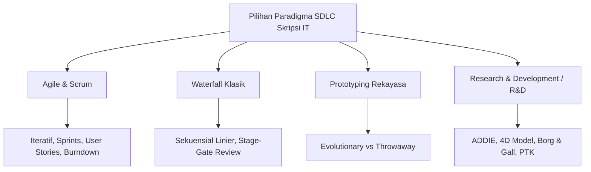
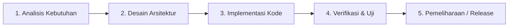
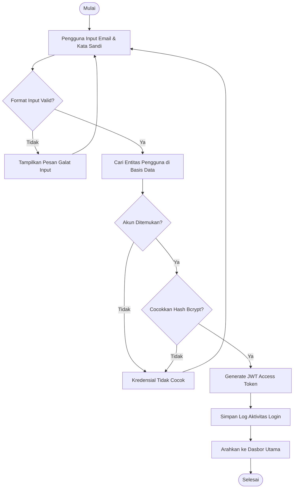
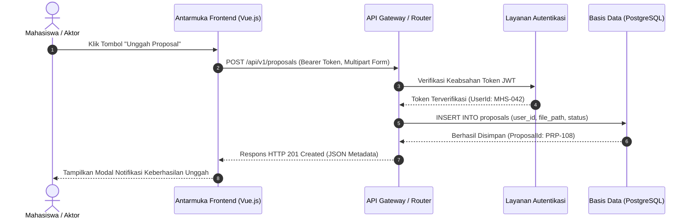
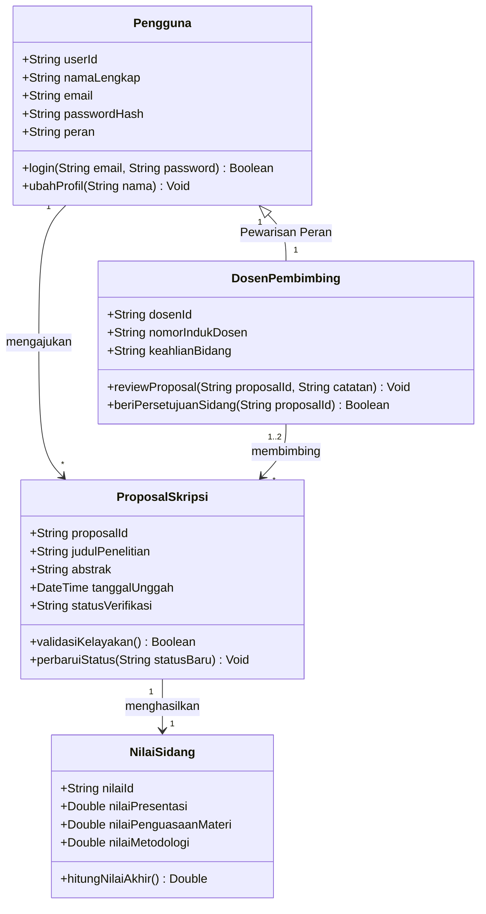
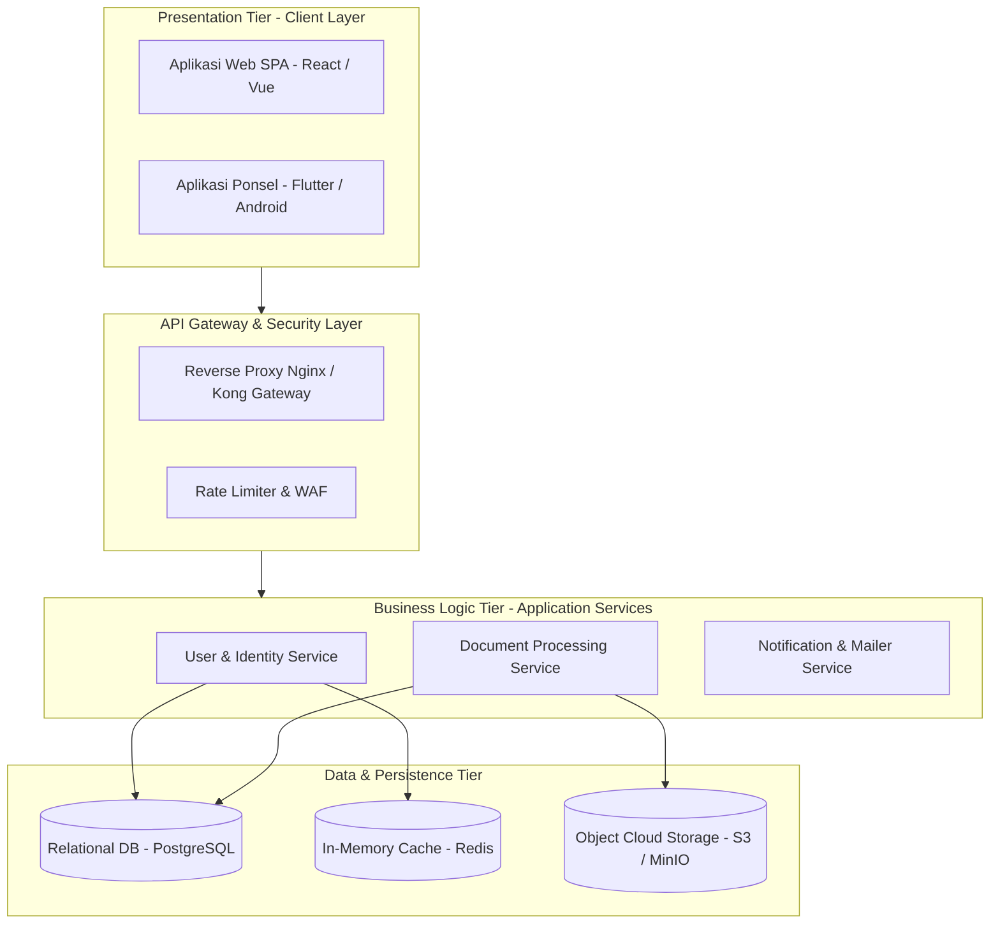

# Pedoman Metodologi Rekayasa Perangkat Lunak dan Teknologi Informasi (Skripsi S1)

**Status:** Normatif / Standar Metodologis `nyekripsi`  
**Sasaran Pengguna:** Penulis Skripsi IT/Informatika/Sistem Informasi, Dosen Pembimbing, Dosen Penguji, dan Agen Rekayasa Sistem  
**Rujukan Regulasi & Metodologis:** Standar IEEE Computer Society (SWEBOK v3), ISO/IEC/IEEE 29119 (Software Testing), Pressman & Maxim (2020), Sommerville (2016), Brooke (1996 - SUS), Thiagarajan et al. (1974), Borg & Gall (2003).

---

## 1. Paradigma Rekayasa Perangkat Lunak & Siklus Hidup Pengembangan (SDLC)

Penelitian skripsi pada rumpun Ilmu Komputer, Teknik Informatika, dan Sistem Informasi umumnya berfokus pada pengembangan produk sistem perangkat lunak, perancangan algoritma, atau rekayasa arsitektur informasi. Pendekatan ini menuntut adopsi siklus hidup pengembangan perangkat lunak (*Software Development Life Cycle* / SDLC) yang terukur dan terverifikasi secara ketat.

---

### 1.1 Metodologi Agile & Kerangka Kerja Scrum

Scrum merupakan kerangka kerja tangkas (*agile framework*) yang bersifat iteratif dan inkremental, sangat tepat untuk pengembangan perangkat lunak skripsi dengan kebutuhan yang terus berkembang.

#### Artefak dan Ritual Utama Scrum:
1. **Product Backlog:**
   - Kumpulan daftar seluruh fitur, fungsi, teknologi, dan perbaikan yang diinginkan pada sistem.
   - Setiap butir backlog dirumuskan dalam format baku **User Story**:
     $$\text{"Sebagai [peran pengguna], saya ingin [fitur / tindakan], sehingga [manfaat / nilai bisnis]."}$$
   - Disertai dengan **Kriteria Keberterimaan (*Acceptance Criteria*)** berbasis skenario (*Given-When-Then*):
     * *Given:* Kondisi prasyarat awal pengguna.
     * *When:* Tindakan aksi yang dilakukan pengguna pada antarmuka.
     * *Then:* Respon keluaran atau perubahan status yang dihasilkan sistem.
2. **Sprint Planning & Sprint Backlog:**
   - Tim pengembang/mahasiswa menentukan cakupan item backlog yang akan diselesaikan dalam kurun waktu sprint (biasanya 1–2 minggu).
   - Estimasi bobot kompleksitas tugas menggunakan deret Fibonacci *Story Points* ($1, 2, 3, 5, 8, 13$).
3. **Definition of Done (DoD):**
   - Kriteria ketat penyelesaian suatu modul: Kode sumber lolos analisis linter, unit test pass $\ge 80\%$, modul terintegrasi pada cabang *main*, dan lolos uji fungsi *black box*.
4. **Daily Standup (Sinkronisasi Harian):**
   - Tiga pertanyaan refleksi: (1) Apa yang diselesaikan kemarin? (2) Apa target pengerjaan hari ini? (3) Hambatan teknis apa yang dihadapi?
5. **Sprint Review:**
   - Demonstrasi fungsionalitas artefak modul yang berfungsi kepada dosen pembimbing atau pengguna akhir (*stakeholders*).
6. **Sprint Retrospective:**
   - Evaluasi proses kerja internal: *Start* (praktik baru yang perlu dicoba), *Stop* (kebiasaan yang menghambat), dan *Continue* (praktik baik yang dipertahankan).
7. **Sprint Burndown Chart:**
   - Diagram visual yang melacak sisa *Story Points* terhadap sisa hari kerja dalam satu siklus sprint guna memantau kecepatan pengembangan (*velocity*).

---

### 1.2 Model Waterfall (Sekuensial Linier)

Model klasik yang terstruktur secara berurutan (*stage-gate model*). Sangat sesuai untuk skripsi dengan spesifikasi kebutuhan yang telah pasti, jelas, stabil, dan risiko perubahan rendah:

1. **Analisis Kebutuhan (*Requirements Analysis*):** Elisitasi lengkap seluruh kebutuhan sistem (fungsional dan non-fungsional).
2. **Desain Sistem & Perangkat Lunak (*System Design*):** Pemodelan arsitektur sistem, struktur basis data (ERD), diagram alir, dan perancangan antarmuka pengguna (*wireframe/mockup*).
3. **Implementasi & Pengujian Unit (*Implementation*):** Penulisan kode sumber program per modul dan pengujian komponen.
4. **Integrasi & Pengujian Sistem (*Verification & Testing*):** Penggabungan modul ke dalam sistem utuh dan verifikasi kepatuhan terhadap dokumen spesifikasi kebutuhan.
5. **Operasi & Pemeliharaan (*Maintenance*):** Pemasangan (*deployment*) ke lingkungan server produksi dan perbaikan cacat sistem.

---

### 1.3 Model Prototyping

Model yang berfokus pada pembuatan versi awal sistem (*prototype*) secara cepat untuk memfasilitasi komunikasi dengan pengguna:

1. **Evolutionary Prototyping:**
   - Prototipe awal dibangun dengan arsitektur yang solid, kemudian disempurnakan dan diperluas secara bertahap melalui umpan balik pengguna hingga berkembang menjadi sistem produksi final.
2. **Throwaway / Rapid Prototyping:**
   - Prototipe dibangun secara cepat semata-mata untuk mengklarifikasi kebutuhan pengguna atau menguji kelayakan konsep algoritma. Setelah kebutuhan dipahami dengan jelas, prototipe dibuang dan sistem produksi dikodekan ulang dari awal dengan arsitektur bersih.

---

### 1.4 Model Research and Development (R&D) & Tindakan Kelas

Banyak diterapkan dalam skripsi teknologi pendidikan, media pembelajaran interaktif, dan sistem rekayasa perangkat lunak terapan di institusi:

1. **Model ADDIE:**
   - **A - Analysis:** Analisis kebutuhan masalah, karakteristik pengguna sasaran, dan lingkungan teknis.
   - **D - Design:** Perancangan tujuan pembelajaran/sistem, pemilihan media, pembuatan storyboard, perancangan basis data dan UML.
   - **D - Development:** Pembuatan produk perangkat lunak, penyusunan buku panduan, dan validasi kelayakan oleh ahli materi serta ahli media.
   - **I - Implementation:** Penggelaran sistem pada kelompok uji coba terbatas dan uji lapangan operasional.
   - **E - Evaluation:** Evaluasi formatif pada setiap tahapan dan evaluasi sumatif efektivitas produk (misal melalui uji *N-Gain Score*).

2. **Model 4D (Thiagarajan, Semmel, & Semmel):**
   - **Define (Pendefinisian):** Analisis awal-akhir, analisis peserta didik/pengguna, analisis konsep, dan perumusan tujuan spesifik.
   - **Design (Perancangan):** Pemilihan format penyajian, pemilihan media, dan penyusunan prototipe rancangan awal (*initial design*).
   - **Develop (Pengembangan):** Validasi pakar (*expert appraisal*) terhadap rancangan sistem dan pengujian pengembangan (*developmental testing*).
   - **Disseminate (Penyebarluasan):** Pengemasan produk akhir, publikasi ilmiah, dan adopsi oleh institusi sasaran.

3. **Model 10 Langkah Borg & Gall:**
   - Skala pengembangan komprehensif: (1) Riset dan pengumpulan informasi, (2) Perencanaan, (3) Pengembangan bentuk awal produk, (4) Uji coba lapangan awal, (5) Revisi produk utama, (6) Uji coba lapangan utama, (7) Revisi produk operasional, (8) Uji coba lapangan operasional, (9) Revisi produk akhir, (10) Diseminasi dan implementasi.

4. **Penelitian Tindakan Kelas / Sistem (PTK / Action Research):**
   - Siklus berulang: Perencanaan (*Plan*) $\to$ Tindakan (*Act*) $\to$ Pengamatan (*Observe*) $\to$ Refleksi (*Reflect*). Jika kriteria keberhasilan belum tercapai pada Siklus I, dilanjutkan ke Siklus II dengan perbaikan strategi.

---

## 2. Rekayasa Kebutuhan Sistem (*Requirements Engineering*)

Elisitasi kebutuhan merupakan fondasi Bab III varian IT/SE. Kebutuhan diklasifikasikan secara tegas ke dalam Kebutuhan Fungsional dan Non-Fungsional.

### 2.1 Kebutuhan Fungsional (*Functional Requirements* - FR)
Menjelaskan secara eksplisit layanan, proses, kalkulasi, dan transformasi data yang wajib dieksekusi oleh sistem:

| ID Kebutuhan | Nama Kebutuhan | Deskripsi Perilaku Sistem | Aktor / Pengguna | Prioritas (MoSCoW) |
|:---:|---|---|---|:---:|
| `FR-01` | Autentikasi Pengguna | Sistem memvalidasi kredensial pengguna dan menerbitkan token JWT berdurasi 24 jam | Pengguna, Admin | Must have |
| `FR-02` | Pengunggahan Berkas | Sistem memvalidasi format PDF berkas tugas akhir maksimum 20MB dan menyimpannya di Cloud Storage | Mahasiswa | Must have |
| `FR-03` | Verifikasi Plagiasi | Sistem melakukan pencocokan kesamaan naskah menggunakan algoritma Jaccard Similarity | Sistem / Dosen | Should have |
| `FR-04` | Ekspor Laporan | Sistem mengekspor rekapitulasi penilaian sidang ke format berkas spreadsheet | Admin Akademik | Could have |

*Metode Prioritisasi MoSCoW:*
- **Must have:** Fitur mutlak ada (*non-negotiable*), tanpa fitur ini sistem tidak dapat beroperasi.
- **Should have:** Fitur penting bernilai tinggi namun ada solusi alternatif sementara jika ditunda.
- **Could have:** Fitur pelengkap yang diinginkan jika waktu dan sumber daya mencukupi.
- **Won't have (this time):** Fitur yang disepakati untuk tidak dikerjakan pada rilis skripsi saat ini.

---

### 2.2 Kebutuhan Non-Fungsional (*Non-Functional Requirements* - NFR) Berdasarkan Model FURPS+

Model FURPS+ (Robert Grady / Hewlett-Packard) digunakan untuk menstrukturkan atribut kualitas dan batasan arsitektur sistem:

| Kategori FURPS | Atribut Kualitas | Spesifikasi Parameter Terukur | Pengujian Verifikasi |
|---|---|---|---|
| **F - Functionality** | Keamanan Data (*Security*) | Seluruh kata sandi di-hash menggunakan algoritma Bcrypt (cost factor $\ge 10$), transmisi data wajib terenkripsi TLS 1.3. | Analisis Kode Sumber & Penetrasi Keamanan |
| **U - Usability** | Kemudahan Penggunaan | Antarmuka adaptif responsif pada layar ponsel (360px) hingga desktop (1920px), skor evaluasi kuesioner SUS $\ge 70$. | Uji Kuesioner SUS pada 30 Responden |
| **R - Reliability** | Ketersediaan (*Availability*) | Ketersediaan layanan sistem (*uptime*) mencapai $99,5\%$ selama masa pengujian beban 72 jam, penanganan galat jaringan gracefully. | Pemantauan Uptime Server & Log Failover |
| **P - Performance** | Waktu Respon & Throughput | Waktu respon rata-rata API endpoint $< 500$ ms pada beban 100 *concurrent users*, throughput minimum 50 RPS. | Uji Beban Otomatis Apache JMeter / k6 |
| **S - Supportability** | Pemeliharaan & Skalabilitas | Arsitektur backend berbasis modular controller-service-repository, dokumentasi API interaktif Swagger / OpenAPI 3.0. | Review Kualitas Kode & OpenAPI Spec Audit |
| **+ Constraints** | Batasan Platform & Lisensi | Server berjalan pada sistem operasi Linux Ubuntu 22.04 LTS, mesin basis data PostgreSQL 15, pustaka bersifat open source. | Verifikasi Lingkungan Deployment |

---

## 3. Pemodelan Arsitektur & Diagram Berstandar Sintaks Mermaid

Seluruh pemodelan logika, interaksi, dan struktur data dalam skripsi wajib disajikan menggunakan format teks deklaratif diagram Mermaid standar:

### 3.1 Diagram Alir Sistem / Algoritma (*Flowchart TD/LR*)
Menggambarkan alur logika pemrosesan verifikasi autentikasi dan otorisasi:

---

### 3.2 Diagram Sekuens (*Sequence Diagram*)
Menggambarkan interaksi pesan asinkron antara antarmuka pengguna, gateway API, servis backend, dan basis data:

---

### 3.3 Diagram Kelas & Relasi Entitas Data (*Class Diagram*)
Menggambarkan struktur kelas domain perangkat lunak beserta atribut, tipe data, dan relasi kardinalitas:

---

### 3.4 Diagram Arsitektur Blok Sistem (*Tiered Architecture Diagram*)

---

## 4. Strategi Pengujian & Verifikasi Perangkat Lunak

Pengujian pada skripsi IT wajib mencakup verifikasi fungsional (*black box*), evaluasi penerimaan pengguna (*SUS & UAT*), dan pengujian kinerja otomatis.

### 4.1 Pengujian Kotak Hitam (*Black-Box Testing*)

Pengujian kotak hitam berfokus pada masukan (*input*) dan luaran (*output*) tanpa perlu memeriksa kode sumber internal. Menggunakan dua teknik utama:

1. **Partisi Ekivalensi (*Equivalence Partitioning* - EP):**
   - Membagi domain input ke dalam kelas-kelas data valid dan data tidak valid yang dianggap setara perlakuannya oleh sistem.
2. **Analisis Nilai Batas (*Boundary Value Analysis* - BVA):**
   - Menguji nilai-nilai pada batas ekstrem partisi (tepat pada batas minimum, tepat di bawah minimum, tepat di atas minimum, nominal, tepat di bawah maksimum, tepat pada maksimum, dan tepat di atas maksimum).

#### Format Matriks Spesifikasi Kasus Uji Black Box (Bab IV):

| ID Uji | Modul Fitur | Skenario Kasus Uji | Data Masukan (Partisi / BVA) | Hasil yang Diharapkan | Hasil Pengamatan Aktual | Kesimpulan |
|:---:|---|---|---|---|---|:---:|
| `TC-01` | Autentikasi | Login dengan kredensial terdaftar | Email valid & kata sandi cocok | Sistem menerbitkan token JWT, redirect ke dasbor | Token terbit, masuk ke dasbor | **Pass** |
| `TC-02` | Autentikasi | Login dengan format email salah | String `mahasiswa.domain` (tanpa `@`) | Sistem memunculkan pesan validasi format email salah | Pesan galat muncul di bawah input | **Pass** |
| `TC-03` | Validasi IPK | Input batas minimum IPK (BVA) | Nilai IPK = `0.00` | Input diterima sistem sebagai batas terbawah | Sistem menyimpan nilai 0.00 | **Pass** |
| `TC-04` | Validasi IPK | Input di bawah batas minimum (BVA) | Nilai IPK = `-0.01` | Input ditolak dengan notifikasi nilai minimal 0.00 | Sistem memblokir dan menampilkan galat | **Pass** |
| `TC-05` | Validasi IPK | Input batas maksimum IPK (BVA) | Nilai IPK = `4.00` | Input diterima sistem sebagai batas teratas | Sistem menyimpan nilai 4.00 | **Pass** |
| `TC-06` | Validasi IPK | Input di atas batas maksimum (BVA) | Nilai IPK = `4.01` | Input ditolak dengan notifikasi nilai maksimal 4.00 | Sistem memblokir dan menampilkan galat | **Pass** |

---

### 4.2 Evaluasi Kebergunaan Sistem: *System Usability Scale* (SUS)

SUS (John Brooke, 1996) merupakan instrumen terstandarisasi industri untuk mengukur persepsi kemudahan penggunaan sistem secara kuantitatif.

#### 10 Butir Instrumen Baku SUS (Skala Likert 1–5):
Instrumen disusun secara berselang-seling antara pernyataan bernada positif (butir bernomor ganjil) dan pernyataan bernada negatif (butir bernomor genap):

1. **Q1 (+):** Saya merasa ingin sering menggunakan sistem ini (*I think that I would like to use this system frequently*).
2. **Q2 (-):** Saya merasa sistem ini terlalu rumit untuk digunakan (*I found the system unnecessarily complex*).
3. **Q3 (+):** Saya merasa sistem ini mudah digunakan (*I thought the system was easy to use*).
4. **Q4 (-):** Saya merasa membutuhkan bantuan orang teknis untuk menggunakan sistem ini (*I think that I would need the support of a technical person to be able to use this system*).
5. **Q5 (+):** Saya merasa fungsi-fungsi dalam sistem ini terintegrasi dengan baik (*I found the various functions in this system were well integrated*).
6. **Q6 (-):** Saya merasa terlalu banyak hal yang tidak konsisten pada sistem ini (*I thought there was too much inconsistency in this system*).
7. **Q7 (+):** Saya merasa orang lain akan belajar menggunakan sistem ini dengan sangat cepat (*I would imagine that most people would learn to use this system very quickly*).
8. **Q8 (-):** Saya merasa sistem ini sangat membingungkan saat digunakan (*I found the system very cumbersome to use*).
9. **Q9 (+):** Saya merasa sangat percaya diri saat menggunakan sistem ini (*I felt very confident using the system*).
10. **Q10 (-):** Saya perlu membiasakan diri terlebih dahulu sebelum dapat menggunakan sistem ini (*I needed to learn a lot of things before I could get going with this system*).

#### Algoritma Perhitungan Skor SUS Presisi:
Untuk setiap responden, skor dihitung dengan formula matematis:
- **Butir Ganjil ($Q_1, Q_3, Q_5, Q_7, Q_9$):** Kontribusi skor = $\text{Skor Skala} - 1$.
- **Butir Genap ($Q_2, Q_4, Q_6, Q_8, Q_{10}$):** Kontribusi skor = $5 - \text{Skor Skala}$.
- **Skor Total Responden:**
  $$\text{Skor SUS} = \left( \sum_{i \in \text{ganjil}} (Q_i - 1) + \sum_{j \in \text{genap}} (5 - Q_j) \right) \times 2,5$$
- Rentang nilai akhir SUS berada pada skala $0$ hingga $100$.

#### Standar Penilaian Adjective Rating, Grade Scale, & Acceptability (Bangor et al., 2008):

| Rentang Skor SUS | Grade Scale | Adjective Rating | Tingkat Keberterimaan (*Acceptability*) |
|:---:|:---:|:---:|:---:|
| **$\ge 80,3$** | **Grade A** | **Excellent / Best Imaginable** | **Acceptable (Sangat Layak)** |
| **$68,0 - 80,2$** | **Grade B** | **Good** | **Acceptable (Layak / Rata-rata Industri = 68,0)** |
| **$51,0 - 67,9$** | **Grade C** | **OK / Marginal High** | **Marginal (Perlu Penyempurnaan)** |
| **$38,0 - 50,9$** | **Grade D** | **Poor / Marginal Low** | **Not Acceptable (Kurang Layak)** |
| **$< 38,0$** | **Grade F** | **Worst Imaginable** | **Not Acceptable (Tidak Layak)** |

---

### 4.3 Pengujian Keberterimaan Pengguna (*User Acceptance Testing* - UAT)

UAT dilakukan bersama calon pengguna akhir untuk memastikan perangkat lunak memenuhi ekspektasi proses bisnis:
- **Matriks Pengujian Skenario Alur Kerja (*Workflow Scenarios*):** Skenario 1 Pendaftaran Mahasiswa, Skenario 2 Pengunggahan Bab Skripsi, Skenario 3 Verifikasi Dosen Pembimbing.
- **Kriteria Keberterimaan (*Acceptance Rate*):**
  $$\text{Persentase Keberterimaan} = \left( \frac{\text{Jumlah Kasus Uji Diterima}}{\text{Total Kasus Uji UAT}} \right) \times 100\%$$
- Sistem dinyatakan **lolos UAT** apabila persentase keberterimaan mencapai $\ge 85\%$ dan tidak terdapat cacat kritis (*blocker / critical bugs*).

---

### 4.4 Pengujian Beban & Kinerja Otomatis (*Automated Load & Stress Testing*)

Pengujian non-fungsional menggunakan perkakas simulasi konkurensi (Apache JMeter, k6, atau Locust):
- **Metrik Utama yang Dievaluasi:**
  1. **Throughput / Requests Per Second (RPS):** Jumlah permintaan HTTP yang berhasil dilayani per detik.
  2. **Latency / Response Time:** Waktu tempuh respons sistem (median p50, persentil ke-90 p90, persentil ke-99 p99). Standar web interaktif: p90 $< 500$ ms.
  3. **Error Rate:** Persentase respon HTTP status kode $5xx$ atau $4xx$ saat beban puncak. Ambang batas toleransi: $< 1\%$.
