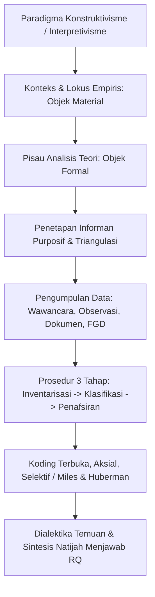
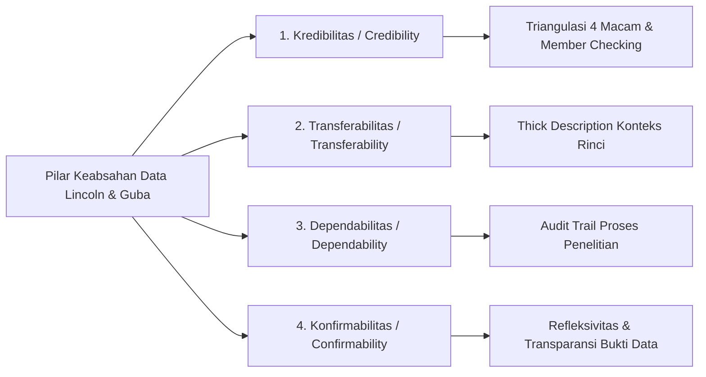
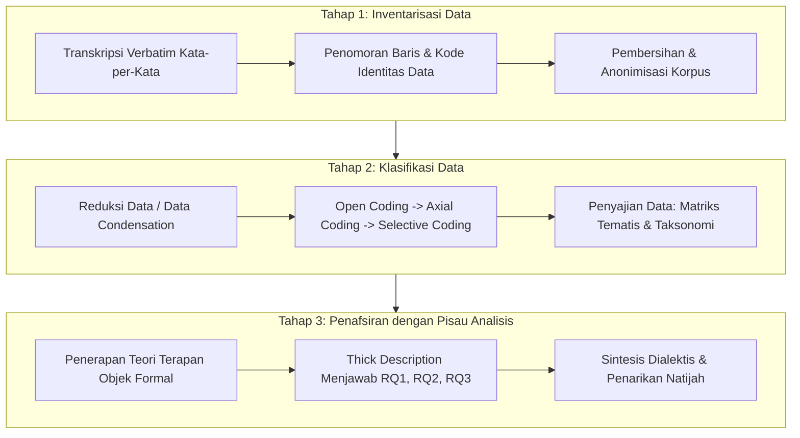

# Pedoman Metodologi Penelitian Kualitatif (Skripsi S1)

**Status:** Normatif / Standar Metodologis `nyekripsi`  
**Sasaran Pengguna:** Penulis Skripsi, Dosen Pembimbing, Dosen Penguji, dan Agen Metodologi  
**Rujukan Regulasi & Metodologis:** Standar Nasional Pendidikan Tinggi (SN-Dikti), Pedoman Penulisan Skripsi S1 Indonesia, Gambar Pedoman Metodologi (`IMG_20261101_025205_545.jpg`, `IMG_20261101_025205_131.jpg`, `IMG_20261101_025207_833.jpg`), Robert K. Yin (2018), Lincoln & Guba (1985), Miles, Huberman & Saldaña (2014), Creswell & Poth (2018).

---

## 1. Paradigma dan Tipologi Desain Riset Kualitatif

Riset kualitatif berakar pada paradigma epistemologi **konstruktivisme** (*constructivism*) dan **interpretivisme** (*interpretivism*). Pendekatan ini meyakini bahwa realitas sosial bersifat majemuk (*multiple realities*), dinamis, dikonstruksi secara kontekstual melalui interaksi antar-aktor, dan hanya dapat dipahami secara mendalam (*in-depth*) melalui pemaknaan subjektif para pelaku.

### 1.1 Tipologi Utama Desain Riset Kualitatif

1. **Studi Kasus (*Case Study* - Robert K. Yin):**
   - Penyelidikan empiris mendalam terhadap suatu fenomena kontemporer dalam konteks kehidupan nyata, terutama ketika batas-batas antara fenomena dan konteks tidak tampak dengan tegas.
   - **Tipologi Desain Kasus Yin:**
     * **Desain Kasus Tunggal Holistik (*Single-Case Holistic Design*):** Meneliti satu kasus utuh pada satu unit analisis tunggal (misal: strategi adaptasi budaya di sebuah perusahaan rintisan).
     * **Desain Kasus Tunggal Terpancang (*Single-Case Embedded Design*):** Meneliti satu kasus besar yang mencakup beberapa sub-unit analisis terintegrasi (misal: implementasi kurikulum merdeka di satu sekolah dengan sub-unit guru, siswa, dan manajemen sekolah).
     * **Desain Multikasus Holistik (*Multiple-Case Holistic Design*):** Membandingkan dua atau lebih kasus independen untuk menemukan pola replikasi harfiah atau teoretis (*cross-case synthesis*).
     * **Desain Multikasus Terpancang (*Multiple-Case Embedded Design*):** Mengkaji multipel kasus di mana tiap kasus memiliki multipel sub-unit analisis.
   - **Tipologi Stake (1995):**
     * *Kasus Intrinsik:* Penelitian dilakukan karena kekhasan unik dari kasus itu sendiri.
     * *Kasus Instrumental:* Kasus dipilih sebagai sarana untuk memahami isu teoretis yang lebih luas.

2. **Deskriptif-Analitis (*Descriptive-Analytical*):**
   - Menggambarkan secara komprehensif struktur, dinamika, dan proses interaksi sosial suatu kelompok masyarakat atau komunitas.
   - Mengintegrasikan pendekatan fenomenologi (menggali esensi pengalaman hidup / *lived experiences* menurut Schutz atau Husserl), etnografi (mengamati kebudayaan dan norma kelompok), atau *grounded theory* (membangun proposisi teoretis induktif dari data lapangan).

3. **Analisis Isi / Konten (*Content Analysis*):**
   - Teknik penelitian untuk membuat inferensi yang dapat ditiru (*replicable*) dan valid dari teks (atau materi bermakna lainnya) ke konteks penggunaannya (Krippendorff, 2018).
   - **Analisis Framing (*Framing Analysis*):**
     * **Model Robert N. Entman:** Menganalisis bagaimana media atau komunikator menyeleksi aspek tertentu dari realitas dan membuatnya lebih menonjol (*salience*). Terdiri atas 4 elemen framing:
       1. *Define Problems* (Mendefinisikan masalah spesifik).
       2. *Diagnose Causes* (Mendiagnosis faktor penyebab atau aktor yang bertanggung jawab).
       3. *Make Moral Judgments* (Memberikan penilaian moral terhadap peristiwa).
       4. *Suggest Remedies* (Menawarkan solusi atau justifikasi tindakan perbaikan).
     * **Model Zhongdang Pan & Gerald M. Kosicki:** Membedah wacana melalui 4 struktur teks:
       1. *Struktur Sintaksis:* Susunan pernyataan, judul (*headline*), teras berita (*lead*), latar berita, dan kutipan sumber.
       2. *Struktur Skrip:* Pola penceritaan yang mengemas fakta (kelengkapan 5W+1H).
       3. *Struktur Tematik:* Cara menguraikan proposisi melalui logika sebab-akibat antar-kalimat dan paragraf.
       4. *Struktur Retoris:* Pilihan kata kunci, idiom, metafora, dan elemen visual grafik pendukung.
   - **Analisis Wacana Kritis (*Critical Discourse Analysis* - CDA):**
     * **Model Tiga Dimensi Norman Fairclough:** Menghubungkan (1) Teks mikro-linguistik, (2) Praktik Diskursif (*discourse practice* / proses produksi dan konsumsi teks), dan (3) Praktik Sosio-Kultural (*sociocultural practice* / relasi kuasa dan ideologi hegemoni).
     * **Model Kognisi Sosial Teun A. van Dijk:** Mengkaji interaksi antara Struktur Teks (makrostruktur, superstruktur, mikrostruktur), Kognisi Sosial wartawan/penulis, dan Konteks Sosial masyarakat.

---

## 2. Delineasi Realitas Empiris dan Penentuan Informan

### 2.1 Konteks dan Lokus Penelitian (*Field Setting*)
Konteks kualitatif bukan sekadar alamat geografis, melainkan batasan sosio-kultural, temporal, dan institusional yang melingkupi Objek Material penelitian:
- Menjelaskan rasional pemilihan lokus (*purposive setting*): Mengapa lokus ini unik, representatif, atau krusial untuk menjawab rumusan masalah.
- Batasan waktu (*time boundary*): Rentang observasi lapangan dan interaksi bersama informan.

### 2.2 Logika Penarikan Informan: Sampling Purposif & Saturasi Data
Dalam riset kualitatif, sampel tidak ditarik secara acak probabilitas untuk generalisasi statistik, melainkan menggunakan **Sampling Purposif (*Purposive Sampling*)**:
- Informan dipilih berdasarkan kekayaan informasi (*information-rich cases*) yang relevan dengan pertanyaan penelitian.
- Ukuran jumlah informan dipandu oleh prinsip **Saturasi Data (*Data Saturation*)**: Pengumpulan data lapangan dihentikan ketika wawancara atau observasi tambahan tidak lagi memunculkan tema, wawasan, atau kode baru (*informational redundancy*).

### 2.3 Tipologi dan Kriteria Informan Baku

| Kategori Informan | Definisi & Kriteria Pemilihan | Peran dalam Penyelidikan Empiris | Contoh Konkret |
|---|---|---|---|
| **Informan Kunci (*Key Informants*)** | Aktor yang memiliki otoritas struktural, akses data strategis, dan pemahaman menyeluruh terhadap kebijakan atau fenomena. | Memberikan gambaran makro, kronologi resmi, arah kebijakan, dan dasar hukum keputusan. | Kepala Dinas, Direktur Operasional, Ketua Komisi Etik, Arsitek Sistem Utama. |
| **Informan Utama (*Main Informants*)** | Aktor yang secara langsung terlibat, mengalami, atau menjalankan aktivitas yang diteliti setiap hari. | Memberikan narasi empiris tangan pertama (*first-hand experience*), kendala lapangan nyata, dan makna subjektif. | Staf pelaksana teknis, guru pengajar di kelas, pengguna harian aplikasi, warga terdampak. |
| **Informan Pendukung / Triangulasi (*Secondary Informants*)** | Aktor luar atau pihak terkait yang tidak terlibat langsung namun mengamati atau menerima imbas fenomena. | Menjadi pembanding kritis, melakukan verifikasi silang terhadap klaim informan kunci dan utama. | Pengamat independen, akademisi eksternal, pelanggan/konsumen, perwakilan LSM. |

### 2.4 Matriks Profil Informan Baku (Bab III)

Setiap informan wajib dikodefikasi secara anonim demi perlindungan etis (*confidentiality*):

| Kode Informan | Jabatan / Peran Terkait Kasus | Usia & Pengalaman | Kriteria Inklusi yang Dipenuhi | Teknik Penggalian Data |
|:---:|---|---|---|---|
| `[INF-01]` | Manajer Proyek Sistem Informasi | 38 th / 12 th bidang IT | Memimpin implementasi sejak fase inisiasi proyek | Wawancara Mendalam (60 menit) |
| `[INF-02]` | Pengembang Backend Senior | 29 th / 6 th bidang IT | Bertanggung jawab atas integrasi arsitektur microservice | Wawancara Mendalam & Uji Artefak Kode |
| `[INF-03]` | Pengguna Operasional Harian | 34 th / 4 th pengguna | Mengoperasikan sistem lebih dari 20 transaksi per hari | Observasi Langsung & Wawancara Terarah |
| `[INF-04]` | Konsultan Keamanan Siber | 45 th / 18 th bidang IT | Menilai keandalan audit eksternal sistem | Wawancara Triangulasi Ahli |

---

## 3. Teknik Pengumpulan Data Kualitatif

### 3.1 Wawancara Mendalam Semi-Terstruktur (*In-depth Semi-Structured Interview*)
- Memanfaatkan **Pedoman Wawancara (*Interview Guide*)** yang disusun berdasarkan indikator teori rujukan di Bab II, namun bersifat lentur (*flexible*).
- Menerapkan teknik penelusuran lebih dalam (*probing*):
  * *Detail Probing:* "Bisa diceritakan lebih detail urutan kejadian saat sistem gagal merespon?"
  * *Elaboration Probing:* "Ketika Anda mengatakan 'sangat rumit', apa contoh tindakan yang paling memakan waktu?"
  * *Clarification Probing:* "Apakah yang Anda maksud adalah keterbatasan perangkat atau pelatihan yang kurang?"
- Wajib melakukan perekaman audio dengan izin tertulis (*informed consent*) dan membuat catatan transkripsi kata-per-kata (*verbatim*).

### 3.2 Observasi Partisipatif (*Participant Observation*)
- Mengacu pada tipologi keterlibatan Spradley (1980):
  * *Partisipasi Pasif:* Peneliti hadir di lokasi namun tidak berinteraksi langsung dalam aktivitas.
  * *Partisipasi Moderat:* Peneliti berada di lokasi dan kadang-kadang terlibat dalam interaksi tertentu.
  * *Partisipasi Aktif:* Peneliti sepenuhnya membaur dalam kegiatan komunitas untuk merasakan ritme kerja.
- Pembuatan **Catatan Lapangan (*Field Notes*)** yang memisahkan:
  * **Catatan Deskriptif:** Rekaman faktual apa yang dilihat, didengar, dan dirasakan tanpa opini (siapa berbicara dengan siapa, ekspresi, tata letak ruang, durasi waktu).
  * **Catatan Reflektif:** Pemikiran analitis awal peneliti, keraguan, koneksi spontan dengan konsep teori, atau catatan bias pribadi peneliti.

### 3.3 Studi Dokumentasi (*Documentary Review*)
- Penelusuran dokumen resmi untuk melengkapi dan memvalidasi data verbal informan:
  * *Dokumen Primer:* Notula rapat resmi, surat keputusan pimpinan, dokumen SOP, log interaksi sistem, laporan audit kinerja.
  * *Dokumen Sekunder:* Kliping berita media massa, buku monografi, arsip statistik publikasi.

### 3.4 Diskusi Kelompok Terpumpun (*Focus Group Discussion* - FGD)
- Mengumpulkan 6 sampai 10 orang peserta dengan karakteristik homogen atau heterogen terkontrol.
- Peran peneliti sebagai fasilitator/moderator: Menstimulasi dialektika interaktif antar-peserta, mencegah dominasi peserta tertentu, dan menangkap kesepakatan (*consensus*) maupun pertentangan pandangan (*dissent*).

---

## 4. Keabsahan Data (*Data Trustworthiness*)

Dalam penelitian kualitatif, keabsahan data tidak diuji melalui reliabilitas instrumen statistik, melainkan mengacu pada standar epistemologis **Lincoln dan Guba (1985)** yang mencakup empat pilar:

### 4.1 Empat Kriteria Keabsahan Data Lincoln & Guba

1. **Kredibilitas (*Credibility* - Validitas Internal):**
   - Menjamin bahwa temuan penelitian akurat dari sudut pandang partisipan dan fenomena sebenarnya.
   - Dicapai melalui: perpanjangan pengamatan (*prolonged engagement*), ketekunan pengamatan (*persistent observation*), triangulasi, dan pemeriksaan sejawat (*peer debriefing*).
2. **Transferabilitas (*Transferability* - Validitas Eksternal):**
   - Memberikan deskripsi tebal dan rinci (*thick description*) mengenai konteks, lokus, karakteristik informan, dan kondisi lapangan, sehingga pembaca dapat memutuskan kemungkinan penerapan temuan pada konteks lain yang serupa.
3. **Dependabilitas (*Dependability* - Reliabilitas):**
   - Memastikan proses penelitian konsisten dan dapat dipertanggungjawabkan melalui proses audit (*audit trail*) oleh dosen pembimbing terhadap langkah-langkah metodologis dari awal hingga penarikan simpulan.
4. **Konfirmabilitas (*Confirmability* - Objektivitas):**
   - Membuktikan bahwa temuan dan interpretasi bersumber murni dari data empiris lapangan (*grounded in data*), bukan dari fabrikasi, imajinasi, atau prasangka subjektif peneliti.

### 4.2 Protokol Triangulasi Komprehensif (Patton & Denzin)

Riset kualitatif wajib menerapkan minimal dua teknik triangulasi berikut:

1. **Triangulasi Sumber (*Source Triangulation*):**
   - Membandingkan dan mengecek balik derajat kepercayaan suatu informasi yang diperoleh melalui sumber informan yang berbeda (misal: membandingkan pernyataan Informan Kunci pimpinan dengan Informan Utama staf pelaksana dan Informan Pendukung pelanggan).
2. **Triangulasi Metode / Teknik (*Methodological Triangulation*):**
   - Menguji kebenaran data empiris dengan memanfaatkan berbagai metode pengumpulan data secara simultan (misal: memverifikasi hasil wawancara mendalam melalui observasi langsung di lapangan dan pencocokan dengan dokumen log sistem).
3. **Triangulasi Peneliti / Investigator (*Investigator Triangulation*):**
   - Melibatkan lebih dari satu peneliti atau rekan sejawat (*peer debriefers*) dalam proses koding dan penafsiran data untuk meminimalisasi bias tafsir individu.
4. **Triangulasi Teori (*Theoretical Triangulation*):**
   - Menggunakan lebih dari satu perspektif teoretis dalam membedah dan menafsirkan temuan empiris (misal: menganalisis fenomena penolakan sistem baru dengan memadukan teori resistensi perubahan sosial dan teori penerimaan teknologi TAM).

### 4.3 Uji Periksa Anggota (*Member Checking*)
- Peneliti menyerahkan kembali intisari transkrip wawancara atau draf laporan temuan sementara kepada informan untuk meminta konfirmasi kebenaran narasi, memperbaiki kekeliruan pemaknaan, atau melengkapi informasi yang terlewat.

---

## 5. Prosedur Analisis Data Tiga Tahap

Mengacu pada Gambar Pedoman Metodologi (`IMG_20261101_025205_545.jpg`), analisis data kualitatif wajib dilaksanakan melalui tiga tahapan linier yang terpadu:

### 5.1 Tahap 1: Inventarisasi Data
1. **Transkripsi Verbatim:** Mengubah seluruh rekaman audio hasil wawancara dan catatan lapangan menjadi naskah teks tertulis secara kata-per-kata tanpa menyunting dialek atau menghilangkan jeda makna.
2. **Penomoran Baris Presisi:** Setiap baris transkrip diberi nomor urut (1, 2, 3, ...) guna memudahkan pengutipan verbatim pada Bab IV (misal: `[INF-01: Baris 112–118]`).
3. **Pemberian Kode Unit Data (*Data Logging*):**
   - Format kode informan: `[INF-01-W1]` (Informan 1, Sesi Wawancara 1)
   - Format kode observasi: `[OBS-02-L2]` (Observasi 2, Lokasi 2)
   - Format kode dokumen: `[DOK-03-SOP]` (Dokumen 3, Arsip SOP)
4. **Pembersihan dan Pengarsipan Aman:** Menghilangkan identitas personal sensitif (nama orang, nomor telepon) dan menggantinya dengan nama samaran (*pseudonym*).

### 5.2 Tahap 2: Klasifikasi Data (Miles, Huberman & Saldaña + Prosedur Koding)
Tahap klasifikasi mengintegrasikan teknik koding bertingkat:

1. **Koding Terbuka (*Open Coding*):**
   - Membaca naskah transkrip baris-demi-baris dan memberikan label konseptual awal (*initial code*) pada setiap segmen kalimat yang mengandung makna penting.
   - *Contoh:* Kalimat informan *"Saya bingung karena tombol konfirmasi sering tidak merespons saat jam sibuk"* diberi kode terbuka: `[Laten-Lag-Sistem]` dan `[Kebingungan-Pengguna]`.
2. **Koding Aksial (*Axial Coding*):**
   - Mengelompokkan kode-kode terbuka yang memiliki kemiripan pola ke dalam kategori (*categories*) dan subkategori.
   - Memetakan relasi kausal: kondisi pemicu (*causal conditions*), konteks, strategi tindakan/interaksi (*action/interaction strategies*), dan konsekuensi (*consequences*).
3. **Koding Selektif (*Selective Coding*):**
   - Mengintegrasikan dan menyaring seluruh kategori ke dalam satu atau dua kategori inti (*core categories*) yang merepresentasikan tema sentral temuan penelitian.
4. **Penyajian Data (*Data Display*):**
   - Menyusun matriks perbandingan tematis (*thematic matrix*) yang mempertemukan kategori temuan antar-informan dan bukti observasi.

### 5.3 Tahap 3: Penafsiran Data dengan Pisau Analisis
1. **Membedah Makna Laten (*Latent Meaning*):**
   - Peneliti dilarang sekadar menumpuk kutipan wawancara panjang (*cherry-picking quotes*). Peneliti wajib menafsirkan motif tersembunyi, struktur kuasa, atau implikasi kultural di balik perkataan informan.
2. **Penerapan Pisau Analisis (Applied Theory):**
   - Menggunakan dimensi-dimensi teori terapan yang telah disaring di Bab II untuk menganalisis temuan empiris. Teori difungsikan sebagai kacamata analitis yang membedah mengapa fenomena tersebut terjadi dalam konteks lapangan.
3. **Menjawab Rumusan Masalah (RQ1, RQ2, RQ3):**
   - Setiap tema temuan dikonsolidasikan untuk menjawab secara tuntas pertanyaan penelitian yang telah diajukan di Bab I.
4. **Sintesis Dialektis Menghasilkan Natijah:**
   - Mendialogkan temuan lapangan dengan hasil penelitian terdahulu: Apakah temuan ini memperkuat (*confirming*), memperluas konteks (*extending*), atau membantah (*refuting*) teori yang ada, sehingga melahirkan proposisi baru (*natijah*).

---

## 6. Refleksivitas Peneliti dan Objektivitas Akademik

Dalam penelitian kualitatif, peneliti memegang peran sentral sebagai **instrumen utama (*researcher as primary instrument / human instrument*)**. Oleh sebab itu, integritas penelitian menuntut keterbukaan epistemologis melalui refleksivitas:

### 6.1 Protokol Epoche / Penundaan Prasangka (*Bracketing*)
- Peneliti wajib secara sadar menangguhkan penilaian awal (*suspension of judgment*), asumsi pribadi, dan stereotipe teoretis sebelum terjun ke lapangan. Hal ini dilakukan agar fenomena dapat menampakkan dirinya sendiri apa adanya sesuai perspektif informan (*emic perspective*).

### 6.2 Pernyataan Posisi Peneliti (*Positionality Statement*)
Di Bab III, peneliti wajib mencantumkan narasi posisi peneliti yang menguraikan:
- Latar belakang peneliti dan kedekatannya dengan subjek penelitian (*insider* vs *outsider*).
- Potensi relasi kuasa antara peneliti dan informan (misal: peneliti sebagai mahasiswa meneliti instansi tempat magang) dan bagaimana peneliti menjaga independensi objektivitas ilmiah.
- Batasan etika penelitian: Penjaminan *informed consent*, kerahasiaan identitas informan, dan ketiadaan intervensi manipulatif terhadap data lapangan.
