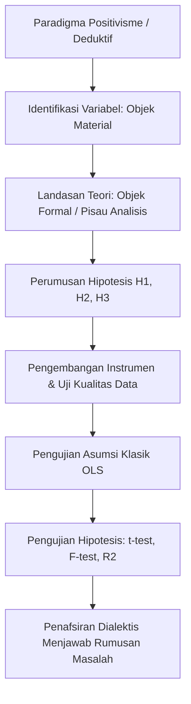
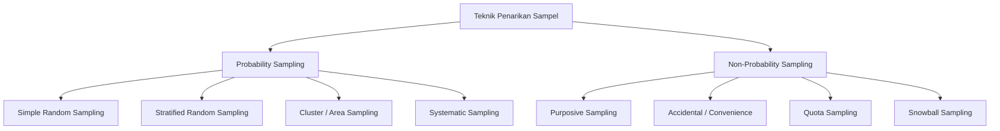
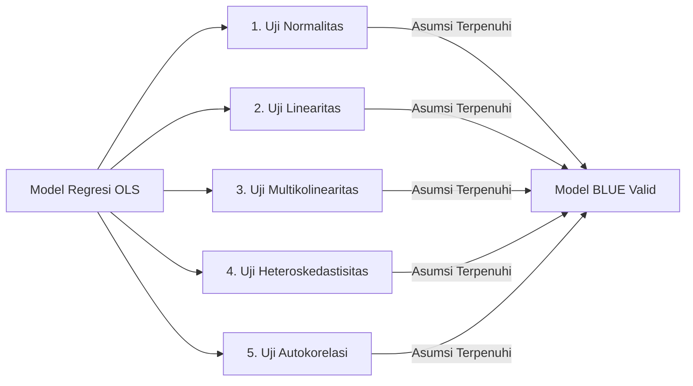

# Pedoman Metodologi Penelitian Kuantitatif (Skripsi S1)

**Status:** Normatif / Standar Metodologis `nyekripsi`  
**Sasaran Pengguna:** Penulis Skripsi, Dosen Pembimbing, Dosen Penguji, dan Agen Metodologi  
**Rujukan Regulasi & Metodologis:** Standar Nasional Pendidikan Tinggi (SN-Dikti), Pedoman Penulisan Skripsi S1 Indonesia, Gambar Pedoman Metodologi (`IMG_20261101_025205_545.jpg`, `IMG_20261101_025205_131.jpg`, `IMG_20261101_025207_833.jpg`), Sugiyono (2022), Hair et al. (2019), Creswell & Creswell (2018).

---

## 1. Paradigma dan Tipologi Desain Riset Kuantitatif

Riset kuantitatif berakar pada paradigma epistemologi **positivisme** (*positivism*) dan **pasca-positivisme** (*post-positivism*). Pendekatan ini memandang realitas empiris bersifat tunggal, objektif, deterministik, terukur, dan dapat diverifikasi melalui pengujian statistik inferensial secara deduktif.

### 1.1 Tipologi Utama Desain Penelitian Kuantitatif

1. **Riset Survei (*Survey Research*):**
   - **Desain Lintas-Seksional (*Cross-Sectional Design*):** Pengumpulan data empiris dari sampel populasi yang representatif pada satu titik waktu tertentu (*snapshot*) untuk menguji korelasi atau pengaruh antar-variabel. Paling lazim digunakan dalam skripsi S1 bidang manajemen, ilmu komunikasi, psikologi, dan sosiologi.
   - **Desain Longitudinal (*Longitudinal Design*):** Pengumpulan data dalam rentang waktu berkelanjutan guna mengamati dinamika tren, panel (*panel studies*), atau kohort (*cohort studies*).

2. **Riset Kuasi-Eksperimen (*Quasi-Experimental Design*):**
   - Diterapkan apabila peneliti tidak dapat melakukan randomisasi penuh (*true random assignment*) terhadap subjek penelitian karena batasan etis atau kondisi kelas/organisasi nyata.
   - **Desain Kelompok Kontrol Non-Ekuivalen (*Non-Equivalent Control Group Design*):** Melibatkan kelompok eksperimen yang diberikan perlakuan (*treatment*) dan kelompok kontrol yang tidak diberikan perlakuan, di mana kedua kelompok menjalani *pretest* dan *posttest*.
     $$\begin{array}{lccc}
     \text{Kelompok Eksperimen:} & O_1 & X & O_2 \\
     \text{Kelompok Kontrol:}    & O_3 & - & O_4
     \end{array}$$
   - **Desain Rangkaian Waktu (*Time-Series Design*):** Melakukan observasi berulang sebelum perlakuan ($O_1, O_2, O_3$) dan setelah perlakuan ($O_4, O_5, O_6$) untuk memastikan kestabilan pengaruh.

3. **Riset Asosiatif dan Kausal (Regresi & Data Panel):**
   - **Regresi Linear Sederhana (*Simple Linear Regression*):** Menguji pengaruh satu variabel bebas ($X$) terhadap satu variabel terikat ($Y$).
     $$Y = \alpha + \beta X + \epsilon$$
   - **Regresi Linear Berganda (*Multiple Linear Regression*):** Menguji pengaruh simultan dan parsial dari dua atau lebih variabel bebas ($X_1, X_2, \dots, X_k$) terhadap variabel terikat ($Y$).
     $$Y = \alpha + \beta_1 X_1 + \beta_2 X_2 + \dots + \beta_k X_k + \epsilon$$
   - **Regresi Data Panel (*Panel Data Regression*):** Menggabungkan data deret waktu (*time series*) dan lintas individu (*cross-section*) pada emiten/wilayah selama beberapa tahun berturut-turut. Menggunakan tiga estimasi model:
     * *Common Effect Model* (CEM / Pooled OLS)
     * *Fixed Effect Model* (FEM / Least Squares Dummy Variable)
     * *Random Effect Model* (REM / Generalized Least Squares)
     * Pemilihan model panel ditentukan melalui:
       - **Uji Chow (*Chow Test*):** Menguji CEM vs FEM (jika $p < 0,05$ maka pilih FEM).
       - **Uji Hausman (*Hausman Test*):** Menguji FEM vs REM (jika $p < 0,05$ maka pilih FEM; jika $p \ge 0,05$ maka pilih REM).
       - **Uji Lagrange Multiplier (*LM Test*):** Menguji CEM vs REM (jika $p < 0,05$ maka pilih REM).

4. **Analisis Korelasional:**
   - **Korelasi Pearson Product-Moment:** Menguji derajat keeratan hubungan linier antara dua variabel berskala interval atau rasio (data berdistribusi normal).
   - **Korelasi Rank Spearman:** Menguji hubungan monotonik antara dua variabel berskala ordinal atau data yang tidak memenuhi asumsi normalitas parametrik.

---

## 2. Operasionalisasi Variabel

Variabel penelitian adalah atribut, sifat, atau nilai dari orang, objek, atau kegiatan yang mempunyai variasi tertentu yang ditetapkan oleh peneliti untuk dipelajari dan ditarik kesimpulannya.

### 2.1 Taksonomi Peran Variabel

1. **Variabel Bebas / Eksogen (*Independent / Exogenous Variable* - $X$):** Variabel yang mempengaruhi atau menjadi sebab perubahannya atau timbulnya variabel terikat.
2. **Variabel Terikat / Endogen (*Dependent / Endogenous Variable* - $Y$):** Variabel yang dipengaruhi atau yang menjadi akibat karena adanya variabel bebas.
3. **Variabel Mediasi / Intervening (*Intervening / Mediating Variable* - $Z$ atau $M$):** Variabel yang secara teoritis mempengaruhi hubungan antara variabel independen dan dependen menjadi hubungan tidak langsung, berada di antara $X$ dan $Y$. Pengujian signifikansi mediasi dilakukan dengan *Sobel Test* atau *Bootstrapping*.
4. **Variabel Moderasi (*Moderating Variable* - $W$):** Variabel yang memperkuat atau memperlemah hubungan langsung antara variabel independen dengan variabel dependen.

### 2.2 Format Baku Matriks Operasionalisasi Variabel (Bab III)

Setiap variabel wajib dioperasionalkan secara terstruktur dari dimensi teori rujukan di Bab II ke indikator empiris terukur:

| Variabel Penelitian | Definisi Konseptual (Rujukan Bab II) | Dimensi Teoretis | Indikator Empiris Lapangan | Skala Pengukuran | No. Butir Kuesioner |
|---|---|---|---|:---:|:---:|
| **Kualitas Layanan ($X_1$)** | Persepsi pengguna atas keunggulan layanan sistem (Parasuraman et al., 1988) | 1. Keandalan (*Reliability*) | 1.1 Akurasi pengolahan data 1.2 Kestabilan server | Likert (1–5) | Butir 1, 2 Butir 3, 4 |
| | | 2. Daya Tanggap (*Responsiveness*) | 2.1 Kecepatan respon keluhan 2.2 Kejelasan panduan pengguna | Likert (1–5) | Butir 5, 6 Butir 7, 8 |
| **Kepuasan Pengguna ($Y$)** | Tingkat perasaan senang atau kecewa yang dihasilkan dari membandingkan kinerja produk (Kotler & Keller, 2016) | 1. Konfirmasi Harapan | 1.1 Kesesuaian fitur dengan kebutuhan 1.2 Efisiensi waktu penyelesaian tugas | Likert (1–5) | Butir 9, 10 Butir 11, 12 |
| | | 2. Minat Merekomendasikan | 2.1 Kesediaan merekomendasikan ke rekan | Likert (1–5) | Butir 13, 14 |

---

## 3. Populasi, Penentuan Ukuran Sampel, dan Teknik Sampling

### 3.1 Populasi Target vs Terjangkau
- **Populasi Sasaran (*Target Population*):** Keseluruhan elemen aggregate yang menjadi sasaran generalisasi kesimpulan penelitian (misal: seluruh mahasiswa aktif di universitas).
- **Populasi Terjangkau (*Accessible Population*):** Bagian populasi yang secara realistis dapat diakses oleh peneliti dalam kurun waktu penelitian (misal: mahasiswa angkatan 2022–2024 yang telah mengambil mata kuliah skripsi).

### 3.2 Teknik Sampling

1. **Probability Sampling (Setiap anggota populasi memiliki peluang sama untuk dipilih):**
   - *Simple Random Sampling:* Pengundian acak murni atau menggunakan generator angka acak.
   - *Stratified Random Sampling:* Populasi memiliki tingkatan/strata heterogen (proporsional atau disproporsional).
   - *Cluster Sampling:* Populasi tersebar dalam kelompok geografis/wilayah terpisah.
   - *Systematic Sampling:* Penarikan sampel berdasarkan interval kelipatan tertentu ($k = N/n$).

2. **Non-Probability Sampling (Peluang anggota populasi tidak sama / berbasis kriteria):**
   - *Purposive Sampling:* Penentuan sampel dengan pertimbangan atau kriteria inklusi dan eksklusi tertentu.
   - *Accidental / Convenience Sampling:* Penarikan responden yang kebetulan ditemui dan bersedia mengisi data.
   - *Snowball Sampling:* Penentuan sampel berantai yang bermula dari sedikit responden kemudian membesar.
   - *Quota Sampling:* Menetapkan kuota responden per segmen hingga jumlah terpenuhi.

### 3.3 Rumus Matematis Penentuan Ukuran Sampel Otoritatif

#### 1. Rumus Slovin
Digunakan untuk populasi berukuran berhingga (*finite population*) dengan margin of error tertentu ($e = 0,05$ atau $0,10$):
$$n = \frac{N}{1 + N(e^2)}$$
- $n$ = Ukuran sampel yang dibutuhkan
- $N$ = Ukuran populasi
- $e$ = Tingkat kelonggaran presisi / batas kesalahan yang ditoleransi (misal $5\% = 0,05$)

*Contoh Perhitungan:* Jika populasi $N = 1.000$ orang dan batas kesalahan $e = 0,05$ ($5\%$):
$$n = \frac{1000}{1 + 1000(0,05^2)} = \frac{1000}{1 + 1000(0,0025)} = \frac{1000}{1 + 2,5} = \frac{1000}{3,5} \approx 285,71 \implies 286 \text{ responden}$$

#### 2. Rumus Isaac dan Michael
Digunakan untuk menentukan ukuran sampel dari populasi berhingga dengan tingkat signifikansi $\alpha = 1\%, 5\%, 10\%$:
$$s = \frac{\chi^2 \cdot N \cdot P(1 - P)}{d^2(N - 1) + \chi^2 \cdot P(1 - P)}$$
- $s$ = Ukuran sampel
- $N$ = Ukuran populasi
- $\chi^2$ = Nilai Chi-Kuadrat tabel dengan $df = 1$ pada taraf kesalahan tertentu ($\chi^2 = 3,841$ untuk $\alpha = 0,05$)
- $P$ = Proporsi populasi yang diasumsikan ($P = 0,50$ untuk variansi maksimum)
- $d$ = Derajat ketepatan presisi yang diinginkan ($d = 0,05$)

#### 3. Rumus dan Tabel Krejcie & Morgan (1970)
Didasarkan pada penyederhanaan formulasi Chi-Kuadrat untuk populasi berhingga dengan tingkat kepercayaan 95% ($d = 0,05$):
$$S = \frac{\chi^2 N P(1 - P)}{d^2(N - 1) + \chi^2 P(1 - P)}$$
- Nilai patokan umum tabel Krejcie & Morgan:
  * Populasi $N = 100 \implies S = 80$
  * Populasi $N = 500 \implies S = 217$
  * Populasi $N = 1.000 \implies S = 278$
  * Populasi $N = 10.000 \implies S = 370$
  * Populasi $N \ge 100.000 \implies S = 384$

#### 4. Aturan Rule of Thumb Hair et al. (Untuk SEM / Multivariat)
Jika ukuran populasi tidak diketahui secara pasti (*infinite population*) atau penelitian menggunakan teknik pemodelan persamaan struktural (*Structural Equation Modeling* / SEM-PLS):
$$5 \times \text{jumlah butir indikator} \le n \le 10 \times \text{jumlah butir indikator}$$
*Contoh:* Jika instrumen penelitian memiliki 30 butir indikator, maka batas sampel minimum adalah $30 \times 5 = 150$ responden, dengan batas ideal $30 \times 10 = 300$ responden.

---

## 4. Instrumen Penelitian, Skala, Validitas, dan Reliabilitas

### 4.1 Skala Pengukuran Sikap
1. **Skala Likert:**
   - 5 Pilihan Tingkat: Sangat Setuju (5), Setuju (4), Netral / Ragu-ragu (3), Tidak Setuju (2), Sangat Tidak Setuju (1).
   - 4 Pilihan (*Forced-Choice* tanpa opsi netral): Sangat Setuju (4), Setuju (3), Tidak Setuju (2), Sangat Tidak Setuju (1) untuk memitigasi bias kecenderungan memusat (*central tendency bias*).
2. **Skala Semantic Differential (Osgood):**
   - Menghubungkan dua kata sifat yang berlawanan (*bipolar adjectives*) dalam kontinum angka 1 sampai 7 (misal: "Sangat Lambat [1] ... Sangat Cepat [7]").
3. **Skala Guttman:**
   - Pengukuran biner yang tegas dan konsisten (misal: "Benar [1] / Salah [0]" atau "Ya [1] / Tidak [0]").

### 4.2 Uji Validitas Butir Instrumen
Validitas menunjukkan sejauh mana suatu instrumen mengukur apa yang seharusnya diukur.

1. **Uji Validitas Butir (Pearson Product-Moment):**
   Korelasi antara skor butir pertanyaan ($X$) dengan skor total seluruh butir ($Y$):
   $$r_{xy} = \frac{N \sum XY - (\sum X)(\sum Y)}{\sqrt{[N \sum X^2 - (\sum X)^2][N \sum Y^2 - (\sum Y)^2]}}$$
   - **Kriteria Validitas:** Butir dinyatakan **valid** jika $r_{\text{hitung}} > r_{\text{tabel}}$ pada derajat kebebasan $df = n - 2$ dan taraf signifikansi $\alpha = 0,05$, serta nilai signifikansi $p < 0,05$.

2. **Uji Validitas Konstruk (CFA / EFA):**
   - Menggunakan *Confirmatory Factor Analysis* (CFA).
   - **Kriteria:** *Factor Loading* (muatan faktor) butir terhadap konstruk wajib $\ge 0,50$ (atau idealnya $\ge 0,70$), dan nilai *Average Variance Extracted* (AVE) $\ge 0,50$.

3. **Uji Validitas Isi (*Content Validity*):**
   - Menggunakan penilaian pakar (*Expert Judgment*) dengan formula indeks Aiken's $V$ atau CVR (*Content Validity Ratio* - Lawshe).

### 4.3 Uji Reliabilitas Instrumen
Reliabilitas menunjukkan konsistensi dan stabilitas hasil pengukuran instrumen ketika diujikan berulang kali.

1. **Koefisien Cronbach's Alpha ($\alpha$):**
   $$\alpha = \left(\frac{k}{k - 1}\right) \left(1 - \frac{\sum \sigma_i^2}{\sigma_t^2}\right)$$
   - $k$ = Jumlah butir pertanyaan dalam instrumen
   - $\sum \sigma_i^2$ = Jumlah varians skor tiap-tiap butir
   - $\sigma_t^2$ = Varians total skor kuesioner
   - **Kriteria Reliabilitas:** Instrumen dinyatakan **andal (*reliable*)** jika koefisien $\alpha \ge 0,70$ (Hair et al., 2019; Nunnally, 1978).

2. **Composite Reliability (CR) untuk Pemodelan SEM:**
   $$CR = \frac{(\sum \lambda_i)^2}{(\sum \lambda_i)^2 + \sum (1 - \lambda_i^2)}$$
   - $\lambda_i$ = Muatan faktor terstandarisasi (*standardized factor loading*)
   - **Kriteria:** Nilai $CR \ge 0,70$ mengindikasikan reliabilitas komposit yang memuaskan.

---

## 5. Pengujian Asumsi Klasik (*Classical Assumption Tests*)

Uji asumsi klasik merupakan prasyarat statistik parametrik yang wajib dipenuhi sebelum model regresi *Ordinary Least Squares* (OLS) dinyatakan tidak bias, konsisten, dan efisien (*Best Linear Unbiased Estimator* / BLUE).

### 5.1 Rincian Protokol Pengujian Asumsi Klasik

1. **Uji Normalitas Residual:**
   - **Tujuan:** Menguji apakah nilai residual dari model regresi berdistribusi normal.
   - **Metode Uji:**
     * Uji *Kolmogorov-Smirnov* (K-S) satu sampel: Residual normal jika nilai Asymp. Sig. (2-tailed) $p > 0,05$.
     * Uji *Shapiro-Wilk*: Direkomendasikan untuk sampel kecil ($n < 50$), normal jika $p > 0,05$.
     * Inspeksi Grafik: Titik-titik pada grafik *Normal P-P Plot of Regression Standardized Residual* menyebar mengikuti garis diagonal.

2. **Uji Linearitas:**
   - **Tujuan:** Memastikan hubungan antara variabel independen dan dependen bersifat linier.
   - **Metode Uji:** Uji *Test for Linearity* pada tabel ANOVA:
     * Nilai *Linearity* $p < 0,05$, dan nilai *Deviation from Linearity* $p > 0,05$.

3. **Uji Multikolinearitas:**
   - **Tujuan:** Memastikan tidak ada korelasi sempurna atau linier yang kuat antar-variabel independen dalam model regresi berganda.
   - **Metode Uji:** Nilai *Variance Inflation Factor* (VIF) dan *Tolerance*:
     $$\text{Tolerance} = 1 - R_j^2, \quad \text{VIF} = \frac{1}{\text{Tolerance}}$$
     * **Kriteria Bebas Multikolinearitas:** Nilai $\text{VIF} < 10$ dan nilai $\text{Tolerance} > 0,10$.

4. **Uji Heteroskedastisitas:**
   - **Tujuan:** Menguji apakah dalam model regresi terjadi ketidaksamaan varians dari residual satu pengamatan ke pengamatan lain (*homoskedasticity*).
   - **Metode Uji:**
     * **Uji Glejser:** Meregresikan nilai mutlak residual ($|e_i|$) terhadap seluruh variabel independen. Bebas heteroskedastisitas jika seluruh nilai signifikansi variabel bebas $p > 0,05$.
     * **Grafik Scatterplot:** Plot antara *Studentized Residual* (SRESID) dan *Standardized Predicted Value* (ZPRED) menyebar secara acak di atas dan di bawah angka 0 tanpa membentuk pola tertentu (tidak membentuk corong, gelombang, atau menyempit).

5. **Uji Autokorelasi:**
   - **Tujuan:** Menguji apakah terdapat korelasi antara kesalahan pengganggu pada periode $t$ dengan kesalahan pengganggu pada periode $t-1$ (wajib untuk data deret waktu / *time series* / data panel).
   - **Metode Uji:**
     * **Uji Durbin-Watson (DW):**
       Model dinyatakan bebas dari autokorelasi positif maupun negatif apabila nilai DW berada di antara batas atas ($d_u$) dan $4 - d_u$:
       $$d_u < d_{\text{hitung}} < (4 - d_u)$$
     * **Uji Breusch-Godfrey LM (*Lagrange Multiplier*):** Dinyatakan bebas autokorelasi jika nilai Prob. Chi-Square $p > 0,05$.

---

## 6. Prosedur Analisis Data Tiga Tahap (Konsisten Gambar Pedoman 10)

Sesuai tuntutan epistemologis Gambar Pedoman Metodologi, analisis data kuantitatif wajib dilaksanakan melalui tiga tahapan berurutan secara ketat:

### 6.1 Tahap 1: Inventarisasi Data
1. **Pengumpulan dan Verifikasi Korpus Kuesioner:** Memeriksa tingkat pengembalian kuesioner (*response rate*) dan kelengkapan respons responden.
2. **Pembersihan Data (*Data Cleaning / Scrubbing*):** Mengidentifikasi data kosong (*missing values*) dan melakukan penanganan imputasi atau penghapusan listwise.
3. **Pemberian Kode dan Skoring (*Scoring & Coding*):** Mengonversi pilihan respon kuesioner ke dalam nilai numerik (1–5) dan memberikan identitas unik responden (`[R-001]`, `[R-002]`, dst.).
4. **Deteksi Data Pencilan (*Outlier Detection*):** Mengidentifikasi data ekstrem univariat (nilai $Z\text{-score} > \pm 3,0$) dan multivariat (jarak *Mahalanobis Distance* dengan $p < 0,001$) agar tidak merusak estimasi regresi.

### 6.2 Tahap 2: Klasifikasi Data
1. **Tabulasi Data Induk Statistik:** Mengelompokkan skor responden ke dalam matriks data induk statistik per variabel dan per dimensi teoretis.
2. **Analisis Statistik Deskriptif:**
   - Menghitung nilai statistik ringkasan: Mean, Median, Modus, Standar Deviasi, Nilai Minimum, dan Nilai Maksimum.
   - Menentukan kriteria kategorisasi skor (Sangat Rendah, Rendah, Sedang, Tinggi, Sangat Tinggi) berdasarkan panjang interval kelas:
     $$\text{Panjang Interval} = \frac{\text{Skor Maksimum} - \text{Skor Minimum}}{\text{Jumlah Kategori}}$$
3. **Penyusunan Matriks Hasil Pengujian Asumsi:** Mengompilasi tabel hasil uji normalitas, linearitas, multikolinearitas, dan heteroskedastisitas.

### 6.3 Tahap 3: Penafsiran Data dengan Pisau Analisis
1. **Menghubungkan Output Statistik dengan Pertanyaan Penelitian (RQ):**
   - Mengaitkan koefisien regresi, nilai $t$, dan nilai $F$ secara langsung untuk menjawab Rumusan Masalah 1, Rumusan Masalah 2, dan Rumusan Masalah 3.
2. **Penerapan Pisau Analisis (Applied Theory):**
   - Peneliti dilarang sekadar membacakan angka tabel SPSS. Peneliti wajib membedah mengapa variabel $X_1$ berpengaruh positif atau mengapa $X_2$ tidak signifikan melalui sudut pandang *Applied Theory* yang telah ditetapkan di Bab II.
3. **Sintesis Dialektis Temuan:** Membandingkan temuan statistik dengan klaim-klaim penelitian terdahulu yang tertera pada Matriks 13 Kolom di Bab II (apakah temuan ini mengonfirmasi, memperluas, atau membantah studi terdahulu).

---

## 7. Pengujian Hipotesis dan Interpretasi Signifikansi

### 7.1 Uji Signifikansi Parsial (Uji t)
- **Fungsi:** Menguji apakah suatu variabel independen secara individual berpengaruh signifikan terhadap variabel dependen dengan mengasumsikan variabel lain konstan.
- **Formulasi Nilai Statistik:**
  $$t_{\text{hitung}} = \frac{b_i - \beta_i}{SE(b_i)}$$
- **Kriteria Pengambilan Keputusan:**
  * Jika $t_{\text{hitung}} > t_{\text{tabel}}$ atau nilai signifikansi $p < 0,05$, maka $H_0$ ditolak dan $H_a$ diterima (Pengaruh variabel secara parsial adalah **signifikan**).
  * Arah hubungan dievaluasi dari tanda koefisien regresi ($+$ untuk pengaruh positif searah, $-$ untuk pengaruh negatif berlawanan arah).

### 7.2 Uji Signifikansi Simultan (Uji F / Omnibus Test)
- **Fungsi:** Menguji apakah seluruh variabel independen secara bersama-sama berpengaruh signifikan terhadap variabel dependen (menguji *goodness of fit* model regresi).
- **Formulasi Nilai Statistik:**
  $$F_{\text{hitung}} = \frac{R^2 / k}{(1 - R^2) / (n - k - 1)}$$
  - $R^2$ = Koefisien determinasi
  - $k$ = Jumlah variabel independen
  - $n$ = Ukuran sampel
- **Kriteria Pengambilan Keputusan:**
  * Jika $F_{\text{hitung}} > F_{\text{tabel}}$ atau nilai signifikansi $p < 0,05$, maka $H_0$ ditolak dan $H_a$ diterima (Model regresi dinyatakan **layak dan fit** secara simultan).

### 7.3 Koefisien Determinasi ($R^2$ dan Adjusted $R^2$)
- **Koefisien Determinasi ($R^2$):** Mengukur seberapa jauh kemampuan model dalam menerangkan variasi variabel dependen ($0 \le R^2 \le 1$).
- **Adjusted $R^2$:** Direkomendasikan untuk regresi berganda karena nilai Adjusted $R^2$ terkoreksi terhadap penambahan jumlah variabel independen dan ukuran sampel:
  $$R_{\text{adj}}^2 = 1 - \left[ \frac{(1 - R^2)(n - 1)}{n - k - 1} \right]$$
- **Interpretasi Nilai:** Misal nilai $R_{\text{adj}}^2 = 0,642$, artinya $64,2\%$ variasi variabel dependen dapat dijelaskan oleh variasi variabel-variabel independen dalam model, sedangkan sisanya ($35,8\%$) dijelaskan oleh faktor lain di luar model penelitian.

### 7.4 Analisis Jalur (*Path Analysis*) dan Pengujian Efek Mediasi
- Dalam model mediasi ($X \to M \to Y$):
  * Pengaruh Langsung (*Direct Effect*): Koefisien lintasan $c'$ dari $X \to Y$.
  * Pengaruh Tidak Langsung (*Indirect Effect*): Perkalian koefisien lintasan $a \times b$ dari $(X \to M) \times (M \to Y)$.
  * Pengaruh Total (*Total Effect*): $c = c' + (a \times b)$.
- **Uji Sobel (*Sobel Test*):**
  $$z = \frac{a \cdot b}{\sqrt{b^2 s_a^2 + a^2 s_b^2}}$$
  Jika nilai statistik $|z| > 1,96$ pada taraf $\alpha = 0,05$, maka efek mediasi dinyatakan signifikan. Pada teknik modern, penggunaan *Bootstrapping* (bias-corrected $95\%$ confidence interval yang tidak memuat angka 0) lebih diutamakan.
