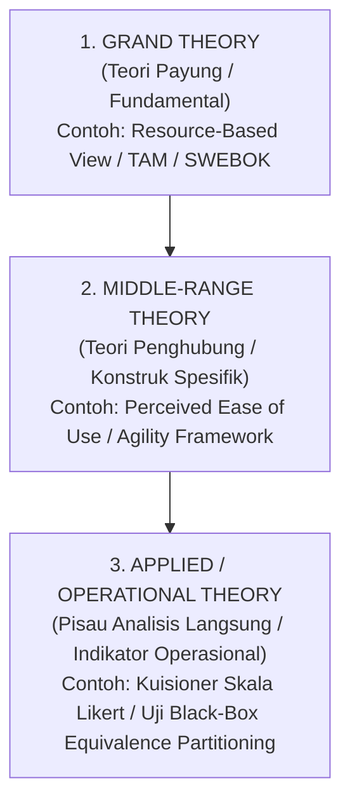
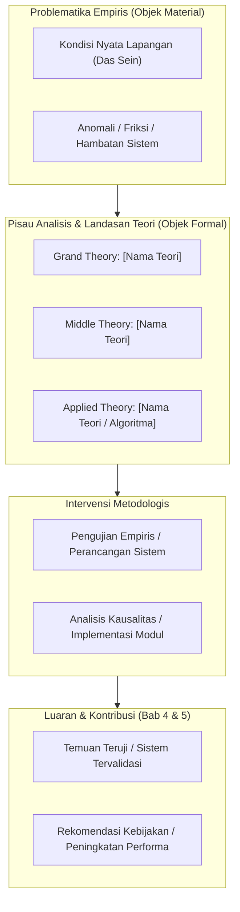

# PANDUAN KERANGKA BERPIKIR & TEORI 3 LEVEL (BAB II)

---

## 1. Hierarki Teori 3 Level
Jangan menumpuk teori tanpa korelasi fungsional. Strukturkan teori Anda ke dalam 3 tingkatan:

---

## 2. Scaffold Diagram Kerangka Berpikir (Mermaid)

Gunakan template diagram Mermaid berikut untuk Sub-Bab 2.3:

