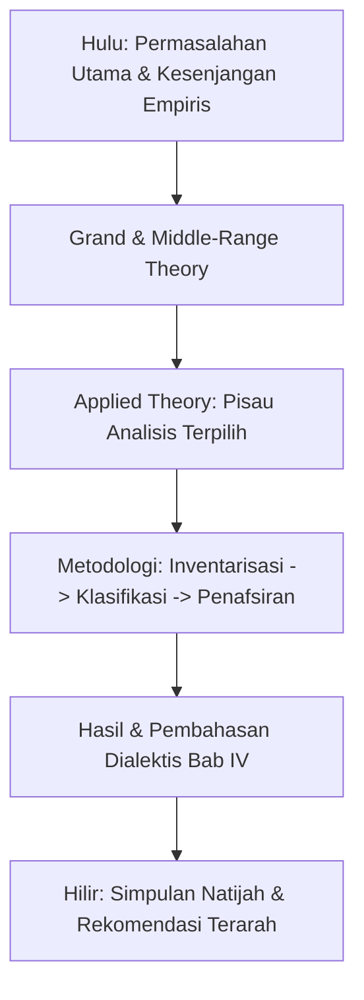

# BAB II: KAJIAN PUSTAKA DAN KERANGKA BERPIKIR

<!-- METADATA & INTEGRITAS TEMPLATE
Standar: SN-Dikti, Pedoman Penulisan Skripsi S1 Indonesia, dan EYD Edisi V
Prinsip Kunci:
1. Penelitian Terdahulu Matriks 13 Kolom: Pemetaan komparatif, sintesis gap, dan penegasan anti-duplikasi.
2. Hierarki Teori Tiga Level: Grand Theory, Middle-Range Theory, dan Applied Theory (Pisau Analisis) + Reduksi Dimensi.
3. Kerangka Berpikir Terstruktur: Bagan alur hulu-hilir dan 5 paragraf narasi jawaban sementara berkorespondensi 1-ke-1 dengan rumusan masalah.
-->

> **Petunjuk Pengisian:**  
> Ganti seluruh teks dalam tanda kurung siku `[...]` dengan konten kajian pustaka Anda. Pastikan setiap rujukan memenuhi standar APA Style Edisi Ke-6/Ke-7 dengan rasio artikel jurnal $\ge 80\%$ dan kemutakhiran terbitan 3–5 tahun terakhir.

---

## 2.1 Penelitian Terdahulu

> **Panduan Metodologis (Refleksi Gambar Pedoman 1):**  
> Sub-bab ini memetakan posisi penelitian saat ini di antara literatur yang telah ada guna membuktikan kebaruan (*state-of-the-art*), mengidentifikasi celah (*research gap*), dan menegaskan secara jujur bahwa judul bukan merupakan duplikasi.

### 2.1.1 Matriks Komparatif Penelitian Terdahulu (13 Kolom)
Tabel di bawah ini memetakan perbandingan komparatif antara penelitian terdahulu yang relevan dengan penelitian yang diusulkan saat ini, mencakup 13 kolom substantif:

| No | Nama Penulis | Judul Penelitian | Objek Material | Objek Formal | Konteks | Metode | Hasil | Pembahasan Singkat | Simpulan | Keterbatasan Penelitian | Rekomendasi | Penerbit | Tahun Terbit |
|:--:|:---|:---|:---|:---|:---|:---|:---|:---|:---|:---|:---|:---|:--:|
| 1 | [Nama Penulis 1] | "[Judul Penelitian 1]" | [Objek Material 1] | [Objek Formal 1] | [Konteks 1] | [Metode 1] | [Hasil 1] | [Pembahasan Singkat 1] | [Simpulan 1] | [Keterbatasan 1] | [Rekomendasi 1] | [Jurnal & Akreditasi] | [Tahun] |
| 2 | [Nama Penulis 2] | "[Judul Penelitian 2]" | [Objek Material 2] | [Objek Formal 2] | [Konteks 2] | [Metode 2] | [Hasil 2] | [Pembahasan Singkat 2] | [Simpulan 2] | [Keterbatasan 2] | [Rekomendasi 2] | [Jurnal & Akreditasi] | [Tahun] |
| 3 | [Nama Penulis 3] | "[Judul Penelitian 3]" | [Objek Material 3] | [Objek Formal 3] | [Konteks 3] | [Metode 3] | [Hasil 3] | [Pembahasan Singkat 3] | [Simpulan 3] | [Keterbatasan 3] | [Rekomendasi 3] | [Jurnal & Akreditasi] | [Tahun] |
| *USULAN* | **[Nama Peneliti]** | **"[Judul Skripsi Saat Ini]"** | **[Objek Material Saat Ini]** | **[Objek Formal Saat Ini]** | **[Konteks Saat Ini]** | **[Metode Saat Ini]** | *(Akan dibuktikan pada Bab IV)* | *(Akan dibahas pada Bab IV)* | *(Natijah yang ditargetkan)* | *(Mengatasi keterbatasan studi terdahulu)* | *(Memberikan rekomendasi 3 sasaran)* | **Skripsi S1 [Program Studi]** | **[Tahun]** |

*(Gunakan template lengkap pada `deep-research/templates/matriks_penelitian_terdahulu_13_kolom_template.md` untuk menyusun baris studi terdahulu dengan preset yang dapat dikonfigurasi: Minimal 5 studi, Default 10 studi, Lanjutan 15 studi, atau Komprehensif 20+ studi sesuai arahan dosen pembimbing).*

### 2.1.2 Sintesis State of the Art dan Research Gap
[Berdasarkan hasil analisis terhadap kolom Keterbatasan dan Rekomendasi pada matriks di atas, uraikan sintesis celah penelitian ke dalam empat kategori:
1. **Empirical Gap:** Fenomena atau dinamika lapangan baru yang belum diungkap oleh peneliti sebelumnya.
2. **Theoretical Gap:** Keterbatasan model teoretis terdahulu yang diperluas dalam penelitian ini.
3. **Contextual Gap:** Perbedaan karakteristik sosial, kultural, demografis, atau institusional pada lokus saat ini.
4. **Methodological Gap:** Peningkatan ketelitian instrumen, desain, atau teknik analisis data dibandingkan riset sebelumnya.]

[Tuliskan pernyataan penegasan batas kemajuan ilmu pengetahuan (*state-of-the-art*): "Hingga saat ini, kajian mengenai [Objek Material] sebagian besar baru mencapai taraf [...], sebagaimana ditunjukkan oleh [Penulis A, Tahun] dan [Penulis B, Tahun]. Penelitian ini memposisikan diri untuk mengisi kekosongan tersebut dengan mengkaji [...]"].

### 2.1.3 Orisinalitas dan Penegasan Anti-Duplikasi
[Tegaskan secara transparan bahwa penelitian ini bukan merupakan duplikasi. Buat tabel kontras diferensiasi yang membandingkan penelitian ini dengan 2–3 penelitian yang paling beririsan pada aspek Objek Material, Objek Formal, Konteks, dan Metode].

---

## 2.2 Landasan Teori

> **Panduan Metodologis (Refleksi Gambar Pedoman 6):**  
> Landasan teori wajib disusun dalam hierarki piramida tiga tingkat: Grand Theory (makro), Middle-Range Theory (meso), dan Applied Theory (mikro). Teori terapan berfungsi langsung sebagai **pisau analisis** pada Bab IV setelah melalui reduksi dimensi.

### 2.2.1 Grand Theory (Teori Makro)
[Uraikan teori payung tingkat tinggi yang melandasi cara pandang bidang keilmuan terhadap fenomena yang diteliti. Contoh: *Systems Theory*, *Resource-Based View*, *Structural Functionalism*, atau *Theory of Computation*].

### 2.2.2 Middle-Range Theory (Teori Menengah)
[Uraikan teori tingkat menengah yang menjembatani abstraksi paradigma makro dengan fenomena empiris spesifik. Jelaskan bagaimana teori ini mengonseptualisasikan relasi antar-variabel atau dinamika proses. Contoh: *Technology Acceptance Model (TAM)*, *Theory of Planned Behavior (TPB)*, atau *Social Cognitive Theory*].

### 2.2.3 Applied / Operational Theory (Pisau Analisis)
[Uraikan teori terapan tingkat mikro yang memiliki konstruk, dimensi, dan indikator terukur yang akan difungsikan langsung sebagai pisau analisis untuk membedah data mentah pada Bab IV].

### 2.2.4 Genealogi dan Kemutakhiran Teori
[Lacak silsilah teori:
1. *Akar Klasik:* Siapa pencetus awal teori, tahun terbit karya seminal, dan konteks kelahirannya.
2. *Lintasan Evolusi:* Bagaimana teori berkembang, dimodifikasi, atau diperluas dalam literatur berikutnya.
3. *Pemanfaatan Mutakhir:* Sitasi minimal 2–3 artikel jurnal bereputasi dalam 3 tahun terakhir yang menerapkan teori ini pada konteks sejenis].

### 2.2.5 Reduksi Dimensi Teori
[Sajikan tabel reduksi dimensi teori rujukan guna memastikan kedalaman (*depth*), bukan keluasan (*breadth*):]

| Dimensi Teori Asli | Status (Dipakai / Dieliminasi) | Alasan Rasional Reduksi & Relevansi Empiris |
|---|:---:|---|
| [Dimensi 1] | Dipakai | Relevan langsung dengan RQ1 dan karakteristik objek material di lapangan. |
| [Dimensi 2] | Dipakai | Menjadi indikator kunci untuk menjawab RQ2. |
| [Dimensi 3] | Dieliminasi | Karakteristik subjek di lokus tidak memenuhi prasyarat dimensi ini. |
| [Dimensi 4] | Dieliminasi | Berada di luar batasan ruang lingkup penelitian yang ditetapkan di Bab 1.5. |

> *"Meskipun teori [Nama Teori] mencakup dimensi [A, B, C, dan D], penelitian ini secara sadar membatasi pengujian hanya pada dimensi [A dan B]. Reduksi ini dilakukan agar analisis lebih fokus pada kedalaman penyelidikan terhadap [Objek Material] sesuai batasan konteks."*

---

## 2.3 Kerangka Berpikir

> **Panduan Metodologis (Refleksi Gambar Pedoman 8):**  
> Kerangka Berpikir menyajikan alur cerita logis berjalannya penelitian dari hulu (masalah) ke hilir (simpulan/natijah). Kerangka berpikir terdiri atas bagan alur dan **wajib memuat narasi 5 paragraf terstruktur**.

### 2.3.1 Bagan Alur Logis Penelitian (Hulu ke Hilir)
[Sajikan diagram alir (Mermaid flowchart) yang memetakan: Masalah Empiris di Hulu $\to$ Pisau Analisis Teori $\to$ Metodologi 3 Tahap $\to$ Temuan & Pembahasan $\to$ Simpulan Natijah di Hilir].

### 2.3.2 Narasi Jawaban Sementara atas Pertanyaan Penelitian (5 Paragraf Wajib)

1. **Paragraf Pengantar:**  
   [Uraikan pengantar singkat, padat, dan to the point dengan menyertakan rujukan teori yang mendasari kerangka pemikiran ini].
2. **Paragraf 1 (Jawaban Sementara RQ1 & Definisi Operasional):**  
   [Uraikan alur logis jawaban hipotetis/asumtif untuk Pertanyaan Penelitian 1. Jelaskan definisi operasional dari kata kunci utama yang muncul pada paragraf ini lengkap dengan sitasi valid].
3. **Paragraf 2 (Jawaban Sementara RQ2 & Definisi Operasional):**  
   [Uraikan alur logis jawaban hipotetis/asumtif untuk Pertanyaan Penelitian 2. Jelaskan definisi operasional dari kata kunci utama yang muncul pada paragraf ini lengkap dengan sitasi valid].
4. **Paragraf 3 (Jawaban Sementara RQ3 & Definisi Operasional):**  
   [Uraikan alur logis jawaban hipotetis/asumtif untuk Pertanyaan Penelitian 3. Jelaskan definisi operasional dari kata kunci utama yang muncul pada paragraf ini lengkap dengan sitasi valid].
5. **Paragraf Penutup (Simpulan Sementara / Janji Ilmiah Pembuktian):**  
   [Uraikan simpulan sementara yang merangkum keseluruhan kerangka berpikir sebagai hipotesis payung atau asumsi sentral yang berjanji akan dibuktikan secara empiris sepanjang pelaksanaan penelitian di Bab IV].

---

## 2.4 Hipotesis Penelitian / Proposisi Penelitian

> **Panduan Metodologis:**  
> - *Untuk Penelitian Kuantitatif:* Rumuskan hipotesis statistik terarah ($H_a$) dan hipotesis nol ($H_0$).  
> - *Untuk Penelitian Kualitatif atau Rekayasa Perangkat Lunak:* Rumuskan proposisi penelitian konseptual atau postulat arsitektural.

Berdasarkan kerangka berpikir yang telah dibangun, hipotesis/proposisi yang diajukan dalam penelitian ini adalah:
- **$H_1$ / Proposisi 1:** [Pernyataan hipotesis/proposisi terkait RQ1].
- **$H_2$ / Proposisi 2:** [Pernyataan hipotesis/proposisi terkait RQ2].
- **$H_3$ / Proposisi 3:** [Pernyataan hipotesis/proposisi terkait RQ3].
