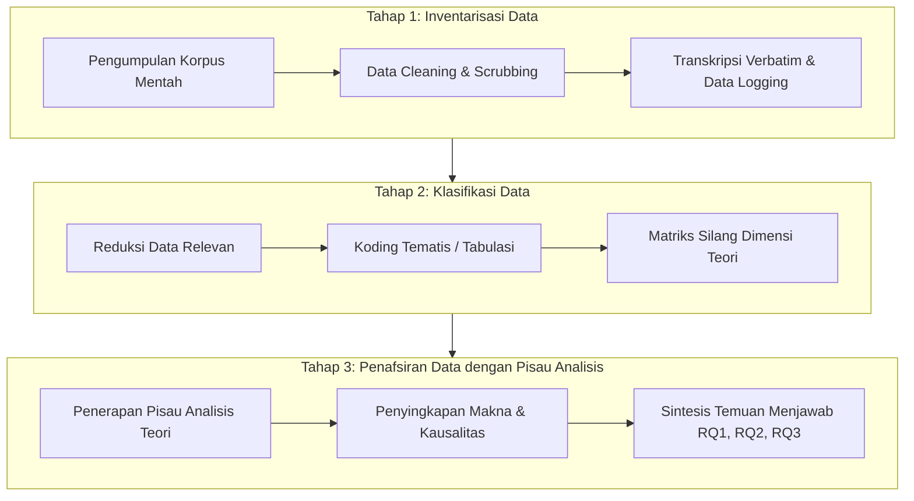
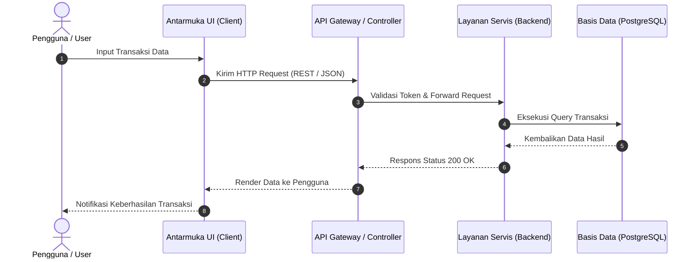
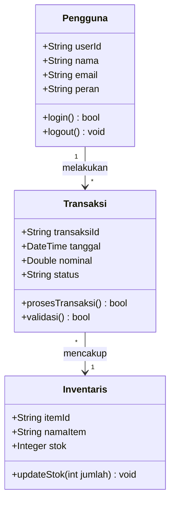

# BAB III: METODOLOGI PENELITIAN / ANALISIS DAN PERANCANGAN SISTEM

<!-- METADATA & INTEGRITAS TEMPLATE
Standar: SN-Dikti, Pedoman Penulisan Skripsi S1 Indonesia, dan EYD Edisi V
Konfigurasi Fleksibilitas Selingkung Kampus:
- Varian A (Klasik - Sosial, Humaniora, Pendidikan, Manajemen):
  "BAB III: METODOLOGI PENELITIAN"
  Struktur: 3.1 Pendekatan & Jenis, 3.2 Objek Material & Formal, 3.3 Populasi & Sampel/Informan, 3.4 Kisi-Kisi Instrumen, 3.5 Validitas & Reliabilitas, 3.6 Prosedur Analisis 3 Tahap.
- Varian B (Rekayasa Perangkat Lunak / IT / Computer Science):
  "BAB III: ANALISIS DAN PERANCANGAN SISTEM"
  Struktur: 3.1 Metodologi Rekayasa (Agile/Scrum/Waterfall/R&D), 3.2 Analisis Kebutuhan Sistem (FR & NFR), 3.3 Pemodelan Arsitektur & Diagram UML (Mermaid Use Case, Sequence, Class Diagram), 3.4 Perancangan Basis Data (ERD) & UI/UX, 3.5 Perancangan Pengujian (Black Box, White Box, SUS).
Prinsip Kunci:
1. Penegasan Epistemologis: Tabel batas tegas Objek Material vs Objek Formal.
2. Matriks Kisi-Kisi Instrumen: Keterlacakan 1-ke-1 dari dimensi teori terapan ke butir instrumen pengumpulan data.
3. Analisis Data Tiga Tahap: Wajib terstruktur runtut (Inventarisasi -> Klasifikasi -> Penafsiran dengan Pisau Analisis).
4. Diagram Sintaks Mermaid Valid: Menggunakan format flowchart, sequence diagram, atau class diagram standar.
-->

> **Petunjuk Pengisian:**  
> Sesuaikan sub-bab dengan paradigma penelitian Anda (Kuantitatif, Kualitatif, atau Rekayasa Perangkat Lunak / IT). Ganti seluruh teks dalam tanda kurung siku `[...]` dengan rancangan metodologi Anda.

---

## 3.1 Pendekatan dan Jenis Penelitian

> **Panduan Metodologis (Refleksi Gambar Pedoman 10):**  
> Tentukan paradigma dan metode spesifik secara tegas dan sertakan referensi metodologi yang otoritatif:
> - **Kuantitatif:** Survei eksplanatori/deskriptif, Kuasi-Eksperimen (*quasi-experiment*), Analisis Korelasional, atau Regresi Linear/Berganda.
> - **Kualitatif:** Studi Kasus (*single/multiple case study*), Deskriptif-Analitis, atau Analisis Isi/Konten (*content analysis*).
> - **Rekayasa Perangkat Lunak / IT:** Agile (Scrum/Kanban), Waterfall, Prototyping, atau Research and Development (R&D / model ADDIE / Borg & Gall).

Penelitian ini menggunakan pendekatan [Kuantitatif / Kualitatif / Rekayasa Perangkat Lunak] dengan jenis metode [sebutkan metode spesifik, misal: Studi Kasus Terpancang / Survei Eksplanatori / Model Scrum], sebagaimana dirujuk dari [Nama Penulis Metodologi, Tahun]. Pendekatan ini dipilih karena karakteristik permasalahan dalam penelitian ini menuntut [berikan alasan rasional pemilihan metode sesuai sifat data].

---

## 3.2 Objek Material dan Objek Formal Penelitian

> **Panduan Metodologis:**  
> Sajikan batasan epistemologis yang membedakan sasaran empiris dari pisau analisis teoretis:

Tabel di bawah ini merinci pembagian peran antara Objek Material dan Objek Formal dalam penelitian ini:

| Komponen Epistemis | Identifikasi Spesifik | Peran Operasional dalam Penelitian |
|---|---|---|
| **Objek Material** | [Sebutkan entitas/korpus/kasus empiris yang diteliti] | Berkedudukan sebagai fenomena lapangan dan sumber data mentah yang dihimpun melalui observasi, wawancara, kuesioner, atau dokumen. |
| **Objek Formal** | [Sebutkan teori/model/algoritma yang dijadikan pisau analisis] | Berkedudukan sebagai pisau bedah analitis (*analytical scalpel*) yang mendasari penyusunan instrumen dan membedah makna di balik data empiris pada Bab IV. |

---

## 3.3 Tempat dan Waktu Penelitian / Populasi dan Sampel / Informan

### 3.3.1 Tempat dan Waktu Penelitian
Penelitian ini dilaksanakan di [sebutkan lokus/instansi/wilayah penelitian], mulai dari bulan [Bulan Tahun] sampai dengan [Bulan Tahun].

### 3.3.2 Populasi dan Sampel / Informan Kunci / Lingkungan Sistem
- **Untuk Penelitian Kuantitatif:**  
  Populasi dalam penelitian ini berjumlah [$N$ orang/unit]. Penentuan ukuran sampel dihitung menggunakan rumus [Slovin / Isaac & Michael / G*Power] dengan tingkat signifikansi $\alpha = 0,05$, menghasilkan sampel sebanyak [$n$ responden]. Teknik sampling yang diterapkan adalah [Simple Random Sampling / Stratified / Purposive Sampling].
- **Untuk Penelitian Kualitatif:**  
  Pemilihan informan ditentukan melalui teknik [Purposive Sampling / Snowball Sampling] dengan kriteria inklusi: (1) [kriteria 1], (2) [kriteria 2], dan (3) [kriteria 3]. Informan kunci terdiri atas [sebutkan profil informan].
- **Untuk Rekayasa Perangkat Lunak / IT:**  
  Lingkungan implementasi dan pengujian mencakup spesifikasi perangkat keras [spesifikasi], perangkat lunak [spesifikasi basis data, server, sistem operasi], serta profil pengguna sasaran pengujian (*user persona*).

---

## 3.4 Teknik Pengumpulan Data dan Kisi-Kisi Instrumen

> **Panduan Metodologis:**  
> Setiap butir instrumen wajib memiliki keterlacakan langsung (*traceability*) ke dimensi teori yang telah disaring di Bab II.

### 3.4.1 Teknik Pengumpulan Data
Data dalam penelitian ini dikumpulkan melalui teknik:
1. **[Kuesioner / Angket]:** Pengukuran persepsi responden menggunakan skala Likert [1–5].
2. **[Wawancara Mendalam]:** Penggalian makna secara terbuka menggunakan panduan wawancara semi-terstruktur.
3. **[Observasi Partisipatif / Lapangan]:** Pengamatan langsung terhadap proses di lokus.
4. **[Studi Dokumentasi]:** Penelusuran arsip resmi, laporan kinerja, log sistem, atau regulasi terkait.

### 3.4.2 Matriks Kisi-Kisi Instrumen (*Traceability Matrix*)

| Variabel / Konstruk | Dimensi Teori Terapan (Bab II) | Indikator Empiris Lapangan | No. Butir / Pertanyaan / Kasus Uji | Sumber Data |
|---|---|---|:---:|---|
| [Variabel X / Konstruk A] | [Dimensi A.1] | [Indikator A.1.1] | Butir 1, 2, 3 | Responden / Informan |
| | [Dimensi A.2] | [Indikator A.2.1] | Butir 4, 5 | Responden / Dokumen |
| [Variabel Y / Konstruk B] | [Dimensi B.1] | [Indikator B.1.1] | Butir 6, 7, 8 | Responden / Informan |
| | [Dimensi B.2] | [Indikator B.2.1] | Butir 9, 10 | Pengujian Sistem / Log |

---

## 3.5 Uji Validitas, Reliabilitas, dan Keabsahan Data

> **Panduan Metodologis:**  
> Uraikan protokol pengujian instrumen atau keabsahan data sesuai pendekatan yang dipilih:

- **Pengujian Kuantitatif:**  
  1. *Uji Validitas Instrumen:* Uji validitas butir menggunakan korelasi *Pearson Product Moment*, di mana butir dinyatakan valid jika $r_{\text{hitung}} > r_{\text{tabel}}$ pada tingkat signifikansi 5%.  
  2. *Uji Reliabilitas Instrumen:* Menggunakan uji *Cronbach's Alpha*, di mana instrumen dinyatakan andal (*reliable*) jika koefisien $\alpha \ge 0,70$.  
  3. *Uji Asumsi Klasik:* Rencana pengujian normalitas data (Kolmogorov-Smirnov), linearitas, multikolinearitas (nilai VIF < 10), dan heteroskedastisitas (uji Glejser/Scatterplot).
- **Keabsahan Data Kualitatif:**  
  Memenuhi 4 kriteria Lincoln & Guba: (1) Kredibilitas (*credibility*) melalui perpanjangan pengamatan dan diskusi teman sejawat; (2) Transferabilitas (*transferability*) melalui deskripsi rinci (*thick description*); (3) Dependabilitas (*dependability*) melalui audit proses penelitian; dan (4) Konfirmabilitas (*confirmability*) melalui transparansi data. Keabsahan data diperkuat dengan **Triangulasi** (Triangulasi Sumber, Triangulasi Teknik, dan Triangulasi Teori).
- **Pengujian Rekayasa Perangkat Lunak:**  
  Pengujian fungsionalitas menggunakan *Black Box Testing* (*Equivalence Partitioning* dan *Boundary Value Analysis*), pengujian kinerja beban (*load/stress testing*), serta pengujian penerimaan pengguna melalui kuesioner *System Usability Scale* (SUS) dan *User Acceptance Testing* (UAT).

---

## 3.6 Prosedur Analisis Data (Tiga Tahap Berurutan)

> **Panduan Metodologis (Refleksi Gambar Pedoman 10 butir 7–12):**  
> Prosedur analisis data **wajib mengimplementasikan 3 tahap linier yang berurutan secara konsisten**:  
> 1. **Inventarisasi Data**  
> 2. **Klasifikasi Data**  
> 3. **Penafsiran Data dengan Pisau Analisis**

Pelaksanaan analisis data dalam penelitian ini dilaksanakan melalui tiga tahapan berurutan sebagai berikut:

*(Catatan Khusus Skripsi IT / Rekayasa Perangkat Lunak: Untuk pemodelan interaksi dan arsitektur kelas pada Bab III varian B, gunakan sintaks Mermaid UML baku di bawah ini):*

### 3.6.1 Tahap 1: Inventarisasi Data
Tahap inventarisasi data merupakan proses awal penghimpunan dan pencatatan seluruh korpus data yang diperoleh dari lapangan:
1. **Pemeriksaan Kelengkapan Korpus:** Memeriksa keterisian seluruh lembar kuesioner yang kembali atau memeriksa rekaman audio wawancara dari seluruh informan.
2. **Pembersihan Data (*Data Cleaning / Scrubbing*):** Mengeliminasi data yang tidak lengkap, anomali input, atau respons yang tidak memenuhi kriteria validitas.
3. **Transkripsi Verbatim:** Mengubah rekaman wawancara menjadi naskah teks transkrip kata-per-kata yang akurat.
4. **Pemberian Kode Identifikasi (*Data Logging*):** Memberikan label kode unik pada setiap unit data (misal: `[INF-01]` untuk informan 1, `[DOK-03]` untuk dokumen 3, `[R-045]` untuk responden 45) guna menjamin kemudahan penelusuran balik (*audit trail*).

### 3.6.2 Tahap 2: Klasifikasi Data
Tahap klasifikasi data merupakan proses pengelompokan, reduksi, dan kategorisasi data mentah yang telah terinventarisasi:
1. **Reduksi Data:** Menyaring informasi yang relevan dan menyisihkan data yang tidak berkaitan langsung dengan rumusan masalah penelitian.
2. **Koding Tematis / Tabulasi Numerik:**
   - *Kualitatif:* Melakukan koding terbuka (*open coding*), koding aksial (*axial coding*), dan pengelompokan ke dalam matriks tema berdasarkan dimensi teori yang telah disaring di Bab II.
   - *Kuantitatif:* Melakukan tabulasi skor kuesioner ke dalam matriks data induk statistik sesuai variabel dan indikator operasional.
   - *IT/SE:* Mengelompokkan log hasil pengujian kasus uji ke dalam kategori *Pass*, *Fail*, dan metrik waktu respon.
3. **Penyusunan Matriks Silang:** Mengorganisasikan data yang terklasifikasi ke dalam bentuk tabel, bagan, atau grafik agar siap ditafsirkan pada tahap berikutnya.

### 3.6.3 Tahap 3: Penafsiran Data dengan Pisau Analisis
Tahap penafsiran merupakan fase analisis kritis di mana data yang telah terklasifikasi dibedah secara mendalam menggunakan landasan teoretis (Applied Theory) sebagai pisau analisis:
1. **Membedah Makna di Balik Data:** Peneliti tidak sekadar mendeskripsikan persentase angka atau menyalin kutipan wawancara, melainkan mengungkap makna substansial, relasi kausalitas, atau motif tersembunyi di balik fakta empiris tersebut.
2. **Penerapan Pisau Analisis:** Menggunakan dimensi-dimensi teori rujukan sebagai kacamata analitis untuk mengevaluasi kesesuaian antara fenomena lapangan (Objek Material) dengan postulat teoretis (Objek Formal).
3. **Penarikan Sintesis Temuan:** Menghubungkan hasil penafsiran secara langsung untuk menjawab Pertanyaan Penelitian 1, Pertanyaan Penelitian 2, dan Pertanyaan Penelitian 3 yang telah dijanjikan pada Bab 1.2, sehingga menghasilkan temuan utama yang siap didiskusikan secara dialektis pada Bab IV.
