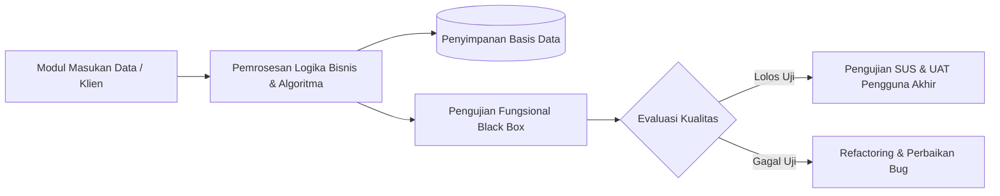

# BAB IV: HASIL PENELITIAN DAN PEMBAHASAN / IMPLEMENTASI DAN PENGUJIAN SISTEM

<!-- METADATA & INTEGRITAS TEMPLATE
Standar: SN-Dikti, Pedoman Penulisan Skripsi S1 Indonesia, dan EYD Edisi V
Konfigurasi Fleksibilitas Selingkung Kampus:
- Varian A (Klasik - Sosial, Humaniora, Pendidikan, Manajemen):
  "BAB IV: HASIL PENELITIAN DAN PEMBAHASAN"
  Struktur: 4.1 Deskripsi Objek Penelitian, 4.2 Hasil Penelitian (Temuan RQ1, RQ2, RQ3), 4.3 Pembahasan (Diskusi Dialektis 3 Arah & Penawaran Gagasan).
- Varian B (Rekayasa Perangkat Lunak / IT / Computer Science):
  "BAB IV: IMPLEMENTASI DAN PENGUJIAN SISTEM"
  Struktur: 4.1 Lingkungan Implementasi & Antarmuka, 4.2 Hasil Eksekusi Pengujian Fungsional (Black Box & White Box Testing), 4.3 Pembahasan Kinerja Sistem, Evaluasi Skor SUS/UAT, dan Refleksi Teori Komputasi.
Prinsip Kunci:
1. Pemisahan Tegas: Sub-bab 4.2 (Hasil Empiris Mentah) vs Sub-bab 4.3 (Pembahasan Dialektis Teoretis).
2. Jawaban Berjenjang: Hasil empiris wajib menjawab tuntas RQ1, RQ2, dan RQ3 secara terpisah.
3. Diskusi Tiga Arah: Mengonfirmasi, Memperluas, atau Membantah Teori + Dialog Komparatif dengan Matriks 13 Kolom.
4. Penawaran Gagasan: Perumusan novelty proposition yang orisinal dan tegas.
5. Diagram Sintaks Mermaid Valid: Visualisasi arsitektur eksekusi dan alur pengujian sistem.
-->

> **Petunjuk Pengisian:**  
> Ganti seluruh teks dalam tanda kurung siku `[...]` dengan temuan data lapangan dan pembahasan kritis Anda. Pastikan pembahasan tidak sekadar mengulang deskripsi angka/tabel dari sub-bab hasil.

---

## 4.1 Deskripsi Objek Penelitian

> **Panduan Metodologis:**  
> Uraikan profil umum subjek/lokus penelitian, demografi responden/informan, sejarah singkat instansi, atau gambaran umum arsitektur sistem eksisting tanpa membocorkan temuan hasil analisis utama:

[Sajikan gambaran umum setting penelitian di sini. Misalnya: profil instansi/komunitas, jumlah dan karakteristik demografis responden (usia, jenis kelamin, masa kerja), atau konfigurasi lingkungan sistem yang menjadi lokus penelitian].

---

## 4.2 Hasil Penelitian

> **Panduan Metodologis (Refleksi Gambar Pedoman 5):**  
> 1. Sajikan data olahan yang berkorespondensi **1-ke-1 secara konsisten** untuk menjawab rumusan masalah.  
> 2. Gunakan representasi visual: tabel statistik, diagram alur, grafik, atau kotak format kutipan verbatim wawancara terstandar.  
> 3. Tunjukkan keterbatasan teknis yang dihadapi selama pengumpulan data lapangan secara jujur.

### 4.2.1 Temuan Penelitian Pertanyaan 1 (RQ1)
[Penyajian Data Empiris untuk Menjawab RQ1]:
- *Kuantitatif:* Sajikan tabel statistik deskriptif, distribusi frekuensi, atau nilai mean/standar deviasi dari variabel pertama.
- *Kualitatif:* Sajikan tema temuan pertama, didukung kutipan wawancara terstandar:
  > *"Kutipan verbatim informan..."* `[Kode: INF-01, Wawancara, 15 Maret 2024]`
- *IT/SE:* Sajikan diagram use case, arsitektur data, atau hasil elisitasi kebutuhan fungsional tahap awal.

### 4.2.2 Temuan Penelitian Pertanyaan 2 (RQ2)
[Penyajian Data Empiris untuk Menjawab RQ2]:
- *Kuantitatif:* Sajikan hasil uji hipotesis, tabel regresi, nilai koefisien jalur ($\beta$), nilai $t$-statistik, dan $p$-value.
- *Kualitatif:* Sajikan analisis relasi antar-kategori tematik atau faktor kausalitas yang ditemukan di lapangan, didukung matriks silang data.
- *IT/SE:* Sajikan implementasi modul sistem, kode utama, diagram sequence, dan tabel hasil eksekusi pengujian *Black Box Testing*.

### 4.2.3 Temuan Penelitian Pertanyaan 3 (RQ3)
[Penyajian Data Empiris untuk Menjawab RQ3]:
- *Kuantitatif:* Sajikan analisis efek moderasi/mediasi, evaluasi koefisien determinasi ($R^2$), atau model prediktif akhir.
- *Kualitatif:* Sajikan pola intervensi, model konseptual solusi lokal, atau evaluasi kritis terhadap efektivitas program.
- *IT/SE:* Sajikan hasil pengujian beban (*load testing*), metrik performa latensi, serta hasil pengukuran *System Usability Scale* (SUS) dan *User Acceptance Testing* (UAT).

### 4.2.4 Ringkasan Temuan Utama dan Keterbatasan Lapangan
[Rangkum intisari temuan empiris utama yang dihasilkan dari sub-bab 4.2.1–4.2.3. Akui secara terbuka dan transparan keterbatasan teknis data yang dihadapi saat pengumpulan data di lapangan].

---

## 4.3 Pembahasan (Diskusi Dialektis)

> **Panduan Metodologis (Refleksi Gambar Pedoman 13):**  
> **ATURAN MUTLAK:** Pembahasan **DILARANG KERAS** hanya menceritakan kembali angka-angka tabel atau transkrip dari Sub-bab 4.2! Pembahasan adalah panggung dialektika saintifik tingkat tinggi tempat **Objek Formal (Teori) membedah Objek Material (Data Lapangan)**.

### 4.3.1 Dialektika Temuan Empiris dengan Landasan Teori (3 Arah Hubungan)

Panggil kembali teori terapan (*Applied Theory*) dari Bab 2.2 sebagai pisau analisis untuk membedah temuan utama. Uraikan secara kritis posisi temuan penelitian ini terhadap teori rujukan ke dalam salah satu atau kombinasi dari **Tiga Arah Hubungan Teoretis**:

1. **Arah 1: Mengonfirmasi / Memperkuat Teori (*Confirming*):**  
   [Jelaskan bagaimana temuan data lapangan sejalan dengan postulat teori. Tunjukkan bahwa teori tersebut terbukti tangguh (*robust*) dan memiliki keberlakuan universal meskipun diuji pada konteks empiris dan lokus baru].
2. **Arah 2: Memperluas Teori (*Extending*):**  
   [Jelaskan jika ada temuan empiris unik di lapangan yang belum tercakup dalam dimensi teori asli. Usulkan dimensi baru, variabel penyela, atau modifikasi konseptual yang memperkaya teori tersebut (misal: penambahan dimensi kearifan lokal atau literasi risiko digital)].
3. **Arah 3: Membantah / Mengoreksi Teori (*Refuting / Falsifying*):**  
   [Tunjukkan anomali lapangan di mana temuan data bertentangan dengan asumsi teori rujukan. Jelaskan secara epistemologis mengapa teori tersebut gagal menjelaskan realitas di lokus ini (misal: akibat friksi budaya, keterbatasan infrastruktur, atau intervensi regulasi setempat). Analisis falsifikasi ini bernilai orisinalitas tinggi dalam tradisi Karl Popper].

### 4.3.2 Dialog Komparatif dengan Penelitian Terdahulu (Matriks 13 Kolom)

Bandingkan temuan penelitian saat ini dengan temuan studi terdahulu yang telah dirangkum dalam Matriks 13 Kolom pada Bab 2.1:
- *Di mana letak kesesuaian temuan penelitian ini dengan studi sebelumnya?* (Sitasi literatur yang sejalan).
- *Di mana letak perbedaan signifikan temuan penelitian ini dibandingkan dengan hasil riset terdahulu?* (Sitasi literatur yang berbeda).
- *Bagaimana penelitian ini berhasil menjawab keterbatasan dan rekomendasi yang diajukan oleh para peneliti terdahulu?*

### 4.3.3 Penawaran Gagasan (*Novelty Proposition*) dan State of the Art

Berdasarkan sintesis antara Objek Material, Objek Formal, dan perbandingan komparatif literatur, susun penawaran gagasan orisinal dari penelitian ini:

> **Pernyataan Penawaran Gagasan (Novelty Proposition):**  
> *"Berdasarkan pembuktian empiris dan analisis dialektis yang telah dipaparkan, penelitian ini mengajukan penawaran gagasan orisinal berupa [uraikan model / proposisi / arsitektur / argumen baru yang tegas dan lugas]. Gagasan ini membedakan penelitian ini dari kajian sebelumnya karena [sebutkan unsur kebaruan utama], sekaligus mengisi kekosongan pengetahuan ilmiah mengenai [isu sentral]."*

[Tutup pembahasan dengan menegaskan bahwa seluruh pertanyaan penelitian telah terjawab tuntas dan penelitian telah mencapai tujuan utama yang ditetapkan sejak Bab I].
